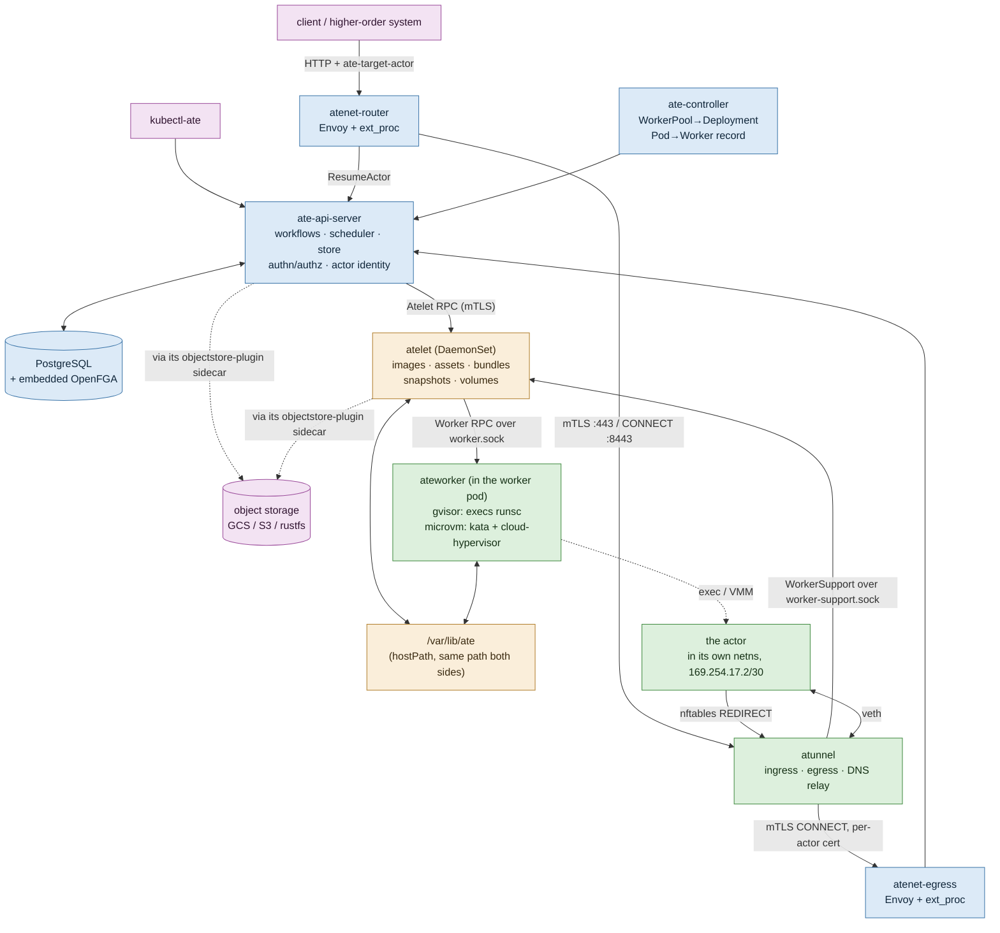

# Agent Substrate Knowledge Base

Learning and reference guides for [`agent-substrate/substrate`](https://github.com/agent-substrate/substrate) — a security-hardened, zero-trust runtime that multiplexes many stateful, mostly-idle "actors" onto few pre-started Kubernetes worker Pods, snapshotting them out of memory when idle and restoring them on demand.

Built from the source tree at commit `fb376fca` (2026-10-17). ~370k lines of Go across 14 binaries.

## Quick start

**New to the project?** Read [learning-path.md](learning-path.md) — a staged roadmap with hands-on milestones.

**Want the whole system in one pass?** Read [end-to-end-on-kind.md](end-to-end-on-kind.md) — one `curl` traced through every component on a local kind cluster, with mermaid diagrams, using the counter demo as the worked example.

**Two facts to get straight before anything else:**

1. **An `ActorTemplate` is not a Kubernetes object.** Only `WorkerPool`, `SandboxConfig` and `CSIDriverConfig` are CRDs. Atespace, ActorTemplate, Actor, Tag, Worker, ActorAssignment, EgressPolicy and AccessPolicy live in **PostgreSQL behind a gRPC API**. Use `kubectl ate`, not `kubectl`.
2. **An atespace is not a Kubernetes namespace.** They are orthogonal axes: actors and templates live in atespaces; WorkerPools live in Kubernetes namespaces.

## Guides

| When you're working on | Read |
|---|---|
| **Anything new** | [architecture.md](architecture.md) — the 10k-ft map: binaries, the two API surfaces, who calls whom, the `internal/` package index |
| **Understanding the whole flow** | [end-to-end-on-kind.md](end-to-end-on-kind.md) — the counter demo traced end to end, including how gVisor is nested inside a runc pod |
| Vocabulary, the data model, snapshots | [resource-model.md](resource-model.md) — every noun precisely; fidelity, pause-vs-suspend, snapshot storage layout, runtime compatibility |
| `ate-api-server`: workflows, scheduling, the store, authn/authz | [control-plane.md](control-plane.md) — the ensure pattern, leases, the transactional outbox, OpenFGA |
| `atelet`, `ateworker-gvisor`, `ateworker-microvm` | [node-and-sandbox.md](node-and-sandbox.md) — the privilege split, `/var/lib/ate`, the asset trust chain, both runtimes |
| The router, the egress gateway, atunnel, DNS | [networking-and-egress.md](networking-and-egress.md) — ext_proc, request parking, the three egress legs, credential injection |
| The proto, validation, codegen | [api-and-validation.md](api-and-validation.md) — AIP divergences, the `uid`+`version` guards, DV tags, `debug_redact` |
| Logs, metrics, traces | [observability.md](observability.md) — why actor identity is barred from metric labels, and what to use instead |
| Installing, configuring, upgrading | [install-and-operations.md](install-and-operations.md) — `ate-setup`, install records, the database, version skew, the upgrade runbook |
| Preview gates, version skew, compatibility | [preview-gates-and-compat.md](preview-gates-and-compat.md) — the two switches, what each release must keep true, the upgrade order |
| Tests, style, CI, the dev loop | [testing-and-dev.md](testing-and-dev.md) — the fail-closed rule, the e2e contract, PR sizing |
| Threat model, identity, the security posture | [security.md](security.md) — the principles with their real Met/In-Progress/Future status, and all 43 threats |
| Getting started as a contributor | [learning-path.md](learning-path.md) |

## The system in one diagram

## Key assumptions these guides make

- **Pre-1.0.** `AGENTS.md` is explicit: **do not add code to stay compatible with older clients, binaries, protos, flags or config.** No proto `reserved`, no deprecated aliases, no version negotiation. Rename and remove outright, updating every caller in the same change. The version-skew policy in [install-and-operations.md](install-and-operations.md) applies *from* 1.0.0.
- **`docs/architecture.md` is partly aspirational** — its own header says so. `docs/security.md`'s Met / In Progress / Future / Out-of-Scope columns are the corrective, and the most honest summary of what actually exists.
- **There is no Kubernetes `RuntimeClass` in this project.** gVisor runs *inside* an ordinary runc pod, exec'd by `ateworker-gvisor`. That is deliberate: a `RuntimeClass` would make the sandbox lifecycle be the pod lifecycle, which is exactly what Substrate decouples. See [end-to-end-on-kind.md § Part 0](end-to-end-on-kind.md).
- **The roadmap is the contribution filter.** `CONTRIBUTING.md`: *"PRs which are not aligned with our near-term goals may be closed without extensive review."* Read `docs/roadmap.md`'s six priorities first.
- **PR titles become release-note lines**, and commit messages carry no issue references.

## The ten most load-bearing files in the repo

If you read nothing else:

| File | Why |
|---|---|
| `AGENTS.md` | the best orientation file; build, layout, and the compat rule |
| `docs/glossary.md` | the vocabulary, precisely |
| `cmd/ateapi/internal/controlapi/workflow.go` | the `stepSpan` doc comment is the design brief for the whole workflow engine |
| `cmd/ateapi/internal/store/atepg/migrations/000001_initial.sql` | most of the data model, in 120 lines |
| `cmd/ateapi/internal/store/atepg/outbox.go` | the header comment: ordering, retention, durability, loss detection |
| `cmd/ateapi/internal/scheduling/scheduling.go` | the whole scheduler, ~300 lines |
| `internal/nodepath/nodepath.go` | the node paths every component shares |
| `cmd/atenet/internal/router/README.md` | the best single document in the repo on any subject |
| `docs/api-style-guide.md` + `docs/api-validation.md` | normative, and enforced in review |
| `docs/version-skew-policy.md` | what each release must keep true, and why |

## How to use this knowledge base

- **First time:** [learning-path.md](learning-path.md), then [end-to-end-on-kind.md](end-to-end-on-kind.md).
- **Before working in an area:** skim the relevant guide from the table above.
- **When a guide is stale:** fix it. The project moves fast and the source of truth is the code plus `docs/`.

Every claim here is traceable to a file in the repo; most quote the source comment or doc directly, because the reasoning in this codebase is usually better than a paraphrase of it.

---

**Source commit:** `fb376fcaf777bf316a48fb91673797f6945f2f9b` (2026-10-17)
