# End-to-End on kind: the Counter Demo, Traced Through Every Component

This is the single page that shows the whole system working. It follows one `curl` from your laptop to a gVisor-sandboxed Go process and back, then follows the suspend that puts it to sleep — naming every process, socket, file path and RPC on the way.

Everything here is a local `kind` cluster: **one Docker container is the whole Kubernetes node.** That matters, because it makes the nesting explicit.

---

## Part 0 — The headline question: is gVisor running inside a runC pod?

**Yes.** And there is **no Kubernetes `RuntimeClass` anywhere in this project.** Grep for it: the only hits are an unrelated `validateRuntimeClasses` in the control plane about *sandbox* classes. Nothing sets `pod.spec.runtimeClassName`.

This is the opposite of how gVisor is usually deployed. The conventional way is: install `runsc` on the node, register a containerd runtime handler for it, create a `RuntimeClass`, and let **kubelet + containerd** start your pod under `runsc`. Substrate does **not** do that, because then the sandbox lifecycle would be the *pod* lifecycle — and the entire point of Substrate is to decouple them. A pod takes seconds to schedule; Substrate needs to activate an actor in ~100 ms, many times, onto a pod that is already running.

So instead: the worker pod is an **ordinary container started by containerd + runc**, and `ateworker-gvisor` — a normal Go process inside it — **execs `runsc` itself** as a child process.

Three nesting levels, each started by a different mechanism:

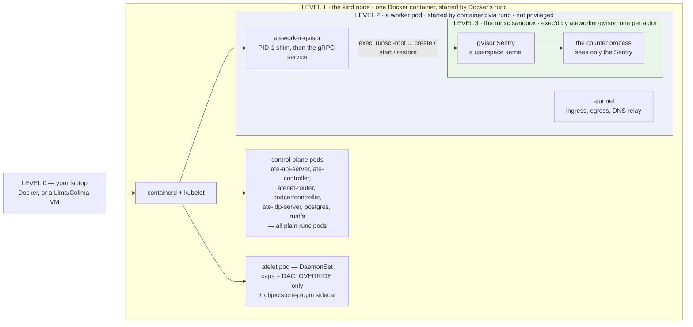

**Three nesting levels, three different mechanisms:**

| Level | What starts it | Isolation used |
|---|---|---|
| kind node | `docker run` → **runc** | an ordinary (privileged) Docker container |
| worker pod | kubelet → containerd → **runc** | namespaces + cgroups + 13 capabilities, **not privileged** |
| actor sandbox | `ateworker-gvisor` → `exec("runsc")` | **gVisor Sentry** — a userspace kernel; the actor's syscalls never reach the host kernel directly |

### Why the worker pod needs those capabilities

`cmd/atecontroller/internal/controllers/workerpool_apply.go:367`. The pod drops `ALL` then adds exactly:

```
NET_ADMIN SYS_ADMIN SYS_CHROOT SYS_PTRACE
SETUID SETGID SETPCAP SETFCAP
DAC_OVERRIDE FOWNER CHOWN MKNOD NET_RAW
```

and the code says why each group is there:

- `SETUID`/`SETGID`/`SETPCAP`/`SETFCAP` — runsc's **gofer** maps a full-range identity in a user namespace.
- `SYS_ADMIN`/`SYS_CHROOT`/`SYS_PTRACE` — the Sentry **pivots root** and **traces** the application.
- `NET_ADMIN`/`NET_RAW` — actor networking programs the **veth pair and nftables rules**.
- `DAC_OVERRIDE`/`FOWNER`/`CHOWN`/`MKNOD` — the OCI rootfs is unpacked and device nodes created as root over image-owned trees.

Plus two deliberate relaxations, both because **the sandbox child calls `pivot_root()`**:

- `seccompProfile: Unconfined` — the RuntimeDefault profile denies `pivot_root` *whatever* capabilities you hold, so the sandbox would die during startup on any cluster that defaults seccomp.
- `appArmorProfile: Unconfined` — runsc's own mounts trip the default profile (enforced on GKE COS and Ubuntu, inert on nodes with no AppArmor).

> This replaced a formerly **privileged** worker. Both relaxations are declared **explicitly** rather than inherited, so the worker doesn't depend on the cluster leaving the profiles unset. The code notes "replacing Unconfined with a tailored profile per runtime is a follow-up."

The micro-VM class adds `FSETID` + `DAC_READ_SEARCH` for virtiofsd (which re-applies a fixed capability set to its sandboxed child; the kernel refuses to raise a capability the bounding set omits, so without those two it exits with *"can't apply the child capabilities"* and the VM never gets its virtio-fs device) and also drops the seccomp profile — the trade is explained in the code: virtiofsd parses requests from the guest, so its own namespaces are part of the guest→host boundary, and it confines itself anyway with its own seccomp filter and nine capabilities.

### Where does `runsc` come from?

**Not from the worker image.** The worker image contains only `ateworker-gvisor`. At actor-activation time:

1. `atelet` resolves the pool's `SandboxConfig` → a version → an `assets` map for this node's GOARCH.
2. The **objectstore-plugin sidecar** downloads `gvisor.tar.zstd` from the URL in the config (e.g. `gs://gvisor/...`) into `/var/lib/objectstore-plugin/asset-staging` — a volume **only the plugin mounts**, so atelet never sees unverified bytes — verifies the sha256, and only then copies it under `/var/lib/ate`.
3. `atelet` verifies the sha256 **again**, extracts it into the content-addressed `/var/lib/ate/sandbox-asset-cache/`, and **hard-links** it into `/var/lib/ate/actors/<actorUID>/sandbox-assets/`.
4. `atelet` passes that path to the worker as `RunscPath` in the RPC. `ateworker-gvisor` execs exactly that.

Because `/var/lib/ate` is a **hostPath mounted at the same path in both atelet and every worker pod**, a hard link atelet makes is a file the worker can exec. That shared mount is the whole atelet↔worker data plane.

atelet has **no object-storage credentials of its own** — the plugin holds them. The plugin refuses any URL under a snapshot location. A `gs://` URL the plugin cannot serve is then read **anonymously**, which is how the public `gs://gvisor` bucket works.

---

## Part 1 — Building the cluster

```sh
hack/create-kind-cluster.sh
```

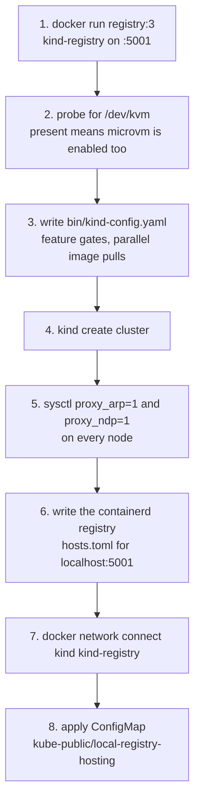

Four decisions in that script that you will care about later:

| What | Why (from the script's own comments) |
|---|---|
| `featureGates: ClusterTrustBundle, ClusterTrustBundleProjection, PodCertificateRequest` + `runtimeConfig: certificates.k8s.io/v1beta1` | `podcertcontroller` **depends** on these. They are not on by default as of Kubernetes v1.36. Without them nothing gets a TLS identity and the install never comes up. |
| `serializeImagePulls: false`, `maxParallelImagePulls: 4` | the install pulls **~570 MB** of third-party images (postgres, prometheus, otel-collector, rustfs, envoy, jaeger) onto one node; kubelet serializes pulls by default and whatever lands at the back of the queue misses its readiness deadline. |
| `sysctl net.ipv4.conf.all.proxy_arp=1` + `net.ipv6.conf.all.proxy_ndp=1` | **required for gVisor loopback pod-to-pod networking.** Set unconditionally. |
| warn if `net.ipv4.neigh.default.gc_thresh3 <= 1024` | every sandbox gets a link-local address and the kernel's **neighbor table ceiling is global across network namespaces**. At the default of 1024, a host with ~1000 sandboxes overflows it (`neighbour: arp_cache: neighbor table overflow!` in dmesg) and connections to sandboxes time out *while the host sits idle*. Only Linux exposes the sysctl; the script warns rather than changing it. |

`ATE_KIND_RESERVED_CPU=2` is worth knowing about: hundreds of sandboxes can starve the kubelet's node heartbeat, and after the 300 s toleration **the taint manager evicts every pod on the node.**

### Installing

```sh
hack/install-ate-kind.sh --deploy-ate-system --credential-provider='{"name":"k8s.io"}'
```

`hack/install-ate-kind.sh` is a tiny wrapper that sets `KO_DOCKER_REPO=localhost:5001`, `KO_DEFAULTPLATFORMS=linux/$(go env GOARCH)`, `ATE_INSTALL_KIND=true`, `BUCKET_NAME=ate-snapshots`, and `KUBECTL_CONTEXT=kind-kind` — then calls `hack/install-ate.sh`, which is itself a shim over `go run ./cmd/ate-setup`. **Every image is built from your checkout with `ko` and pushed to the local registry.**

The kind kustomize overlay (`manifests/ate-install/kind/`) differs from the base in exactly the ways a laptop needs:

| Overlay piece | Effect |
|---|---|
| `rustfs.yaml` | an **in-cluster S3-compatible object store** stands in for GCS |
| `ate-api-server/` + `atelet/` patches | both objectstore-plugin sidecars get `ATE_STORAGE_BACKEND=s3`, `AWS_ENDPOINT_URL=http://rustfs.ate-system.svc:9000`, `AWS_S3_USE_PATH_STYLE`, and the `rustfsadmin`/`rustfsadmin` credentials |
| `ate-otel-config.yaml` | **replaces** the base ConfigMap of the same name, so every component's `envFrom` resolves to the in-cluster collector instead of the GKE one |
| `otel-collector.yaml`, `prometheus.yaml` | local observability; the demo also gets a Jaeger all-in-one in `otel-system` |
| `postgres/` | the bundled single-node PostgreSQL |

`pod-certificate-controller.yaml` is **deliberately absent** from the overlay — the installer applies and deletes it on its own, because re-applying the base file would revert a `WORKERS_PER_SIGNER` override.

### What is running when the install finishes

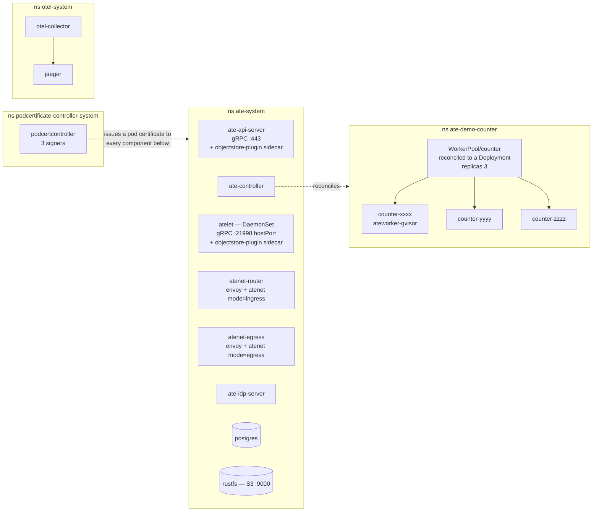

This is an inventory, not a flow — see [Part 5](#part-5--the-complete-interaction-map) for who actually calls whom. The relationships it leaves out: `ate-api-server` owns `postgres` and reaches `rustfs` through its sidecar, `atelet` reaches `rustfs` through its own, and every component exports OTLP to the collector in `otel-system`.

---

## Part 2 — The WorkerPool becomes worker pods, and worker pods become `Worker` records

Two **separate** loops, both in `ate-controller`, and conflating them is a common mistake.

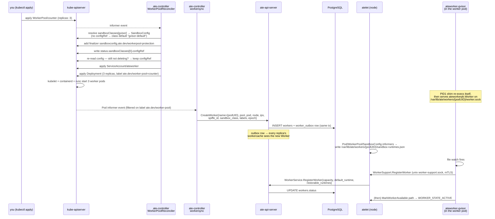

Points worth internalizing:

- **`workersync` keys its workqueue on `{namespace, name, uid}`, not `namespace/name`.** The code explains why: the queue dedupes by key equality, and a pod plus its same-named replacement are *different Workers*. Without the UID, `delete(worker-1, uid-A)` and `add(worker-1, uid-B)` would collapse into one item, the reconcile would read current informer state, see only uid-B, and **leave uid-A's record orphaned in the registry.**
- The label `ate.dev/worker-pool` both names the pool **and** is what marks a pod as a worker pod at all — so it doubles as the pod informer's selector.
- A Worker starts `UNAVAILABLE`, not `ACTIVE`. It becomes schedulable only after `MarkWorkerAvailable`.
- `RegisterWorker` records capacity **and** supported sandbox runtimes **in one write**, so "a Worker is never schedulable without runtime compatibility information to match snapshots against."
- `atelet` jitters its `sandbox-runtimes.json` rewrites, because every atelet observes a `WorkerPool`/`SandboxConfig` change within about a second and **each rewrite makes its workers register again** — without jitter the whole fleet would hit `ate-api-server` at once.
- `atelet` also **prewarms** each worker's default sandbox runtime as the syncer plans it (`cmd/atelet/runtime_prewarm.go`): assets fetched and the pause image pulled ahead of first use, bounded at 10 min/attempt, 8 retries, backoff capped at 5 min. First use remains the correctness path.

### The ActorTemplate, and the golden snapshot it triggers

`kubectl ate create actor-template -f counter-template.yaml` goes to the **gRPC API, not Kubernetes.** Then `ActorTemplateReconciler` builds the golden snapshot *by driving the public lifecycle against itself*:

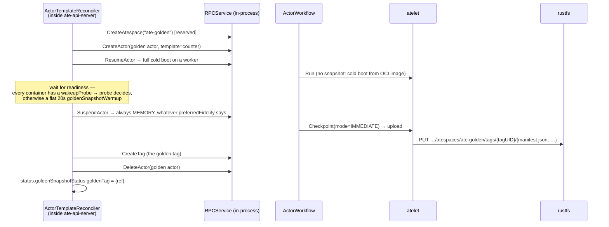

```sh
kubectl ate get actor-templates -a ate-demo-counter
# the golden column shows a UUID once the build has finished
```

A **nonempty `status.goldenSnapshotStatus.error_message` is terminal** — it will not be retried. Reasons: `GoldenTagConflict`, `GoldenActorInvalid`, `GoldenActorCrashed`, `GoldenActorUnexpectedState`. e2e budgets 90 s on gVisor and 10 min on micro-VM (where the golden is a Cloud Hypervisor cold boot *plus* a checkpoint).

### Creating the actor does almost nothing

```sh
kubectl ate create actor my-counter-1 -a ate-demo-counter --template counter
```

One row in PostgreSQL: `state = ACTOR_STATE_SUSPENDED`, no worker, snapshot reference seeded from the template's golden tag. **No compute is consumed and no sandbox exists.** This is the whole premise of the system — you can have a million of these.

---

## Part 3 — `curl` → the actor. The activation path.

```sh
kubectl port-forward -n ate-system svc/atenet-router 8000:80
curl -X POST -H "ate-target-actor: ate-demo-counter/my-counter-1" -i http://localhost:8000/
```

`svc/atenet-router` port 80 → container port **8080** (Envoy's plaintext listener). The Service also publishes 443→8443 (TLS), 8081 (CONNECT), 8444 (CONNECT-TLS).

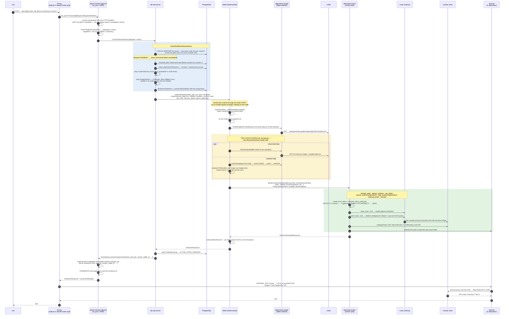

### Six details in that diagram that are easy to get wrong

**1. The router resumes on *every* request, not just the first.** `ResumeActor` is the router's routing primitive. The already-running case is the hot path, which is why the control plane reads the actor *before* taking the lease, and why the lifecycle metric deliberately **skips** clean already-running no-ops — recording them would sample at router QPS and bury cold-resume latency.

**2. `ate-target-actor` selects the Actor. `Host`/`:authority` does not.** `Host` stays application metadata. Normal HTTP rules still apply (clients must send a valid one), and reverse proxies should preserve it. The router **overwrites** `ate-target-actor` with the resolved reference before forwarding, so a client-supplied value cannot select a different actor after resolution. Browsers can't set custom headers, so browser-facing deployments need a user-controlled reverse proxy that writes the header from trusted config — the Jupyter demo shows that with NGINX.

**3. The worker address travels as Envoy *dynamic metadata*, not a header.** Envoy's `ORIGINAL_DST` cluster reads `envoy.filters.listener.original_dst` → `{local, port, worker_spiffe_id}`. But `atunnel` is a *separate process* in the worker pod, not part of Envoy, so it cannot read Envoy metadata — therefore **the actor's target port travels as a real header**, `X-Ate-Target-Port` (`internal/atunnel/ingress`). That split is the reason both mechanisms exist.

**4. Worker pod port 80 is not an actor ingress path.** Ingress lands on `atunnel` at the worker pod's **:443** (mTLS HTTPS), or **:8443** for an mTLS `CONNECT` tunnel. `atunnel` requires the router's SPIFFE ID (`--atunnel-client-identity`) and the router requires the worker's (`worker_spiffe_id` from the assignment). If either is missing, the router fails the request with a 500 — "without the SPIFFE ID, atunnel's identity can't be checked."

**5. The actor's only network interface is a point-to-point /30.** `eth0 = 169.254.17.2/30`, gateway `169.254.17.1`, inside its own netns. The actor has no pod IP, no cluster DNS, no route to the Kubernetes API or to `ate-api-server`. Everything in and out goes through `atunnel`.

**6. The parallel legs matter for latency.** The code's own note: overlapping the snapshot download (~0.5 s warm) with asset fetch + image unpack (~2.5 s on a cold node) "hides whichever leg is shorter, and on a cold node that overlap is large."

### The two parallel paths inside atelet's Restore

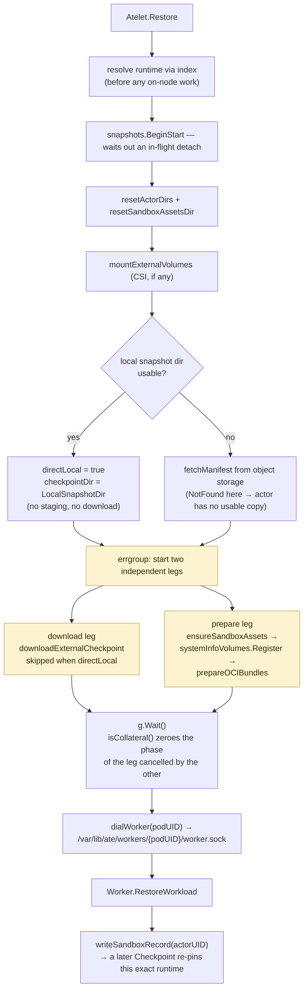

Every phase is timed and emitted **twice from one slice of values** — once as the `ate.actor.restore.duration` metric, once as the `Restore timing breakdown` log record — specifically "so the metric and the log cannot disagree about how long the restore took." Phases: `volume_mount`, `manifest_fetch`, `sandbox_assets`, `download`, `oci_unpack`, `worker_restore`, `total`. A phase left at zero never ran, and the record is emitted **on the way out, so a failed restore still accounts for the phases it completed.**

`ateworker-gvisor` logs its own nested breakdown for the opaque `worker_restore` phase, and the `(gap)` between them is the RPC overhead. `benchmarking/analysis/phase_report.py` joins the two layers into waterfalls — see `docs/dev/suspend-resume-phase-breakdown.md`.

---

## Part 4 — Suspend: putting it back to sleep

```sh
kubectl ate suspend actor my-counter-1 -a ate-demo-counter
```

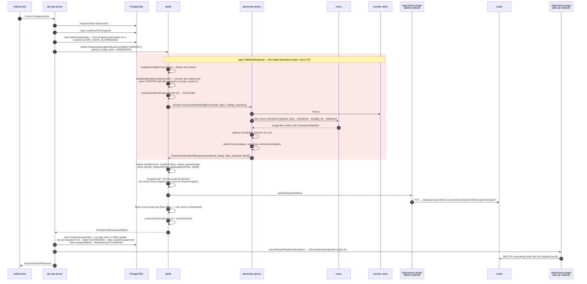

### The ordering constraints, which are load-bearing

- **The local prune happens *after* `CheckpointWorkload`, never before.** The comment spells out the failure it prevents: moving it earlier would leave "the whole checkpoint window with no local snapshot while `LocalSnapshotInfo` still names the pruned one, and a crash there strands the actor for good — a paused actor has no uploaded copy for resume to fall back to, `RequiredNodes` pins it to this node, nothing clears the field."
- **`ForgetLocal` precedes the prune** so the tracker never names a deleted snapshot, even if the checkpoint then fails.
- **Pruning is deliberately outside the `persist` timing window**, because it collects superseded snapshots on *both* upload paths, and timing it as part of an external upload would mix local disk deletion into the object-storage measurement.
- **`IMMEDIATE` upload is not retryable.** `CheckpointWorkload` has already deleted the workload, so a retried Checkpoint cannot redo the upload. A plugin error reaches the control plane as `Internal`, **which crashes the actor** — tracked as #362, because failed external files are not cached.
- **`FinalizeSuspended` commits state and clears the assignment in a single update**, and commits `CRASHED` instead if the latest snapshot cannot be recorded.
- **An actor that borrowed its snapshot from a tag releases nothing** — the tag owns it. That is why `my-counter-1`'s *first* suspend does not delete the golden snapshot.

### Suspend vs Pause

Same code path (`suspendActor(ctx, ref, mode)`); the mode only picks `ateletpb.UploadMode`:

| | **Pause** (`DEFERRED`) | **Suspend** (`IMMEDIATE`) |
|---|---|---|
| atelet does | `moveLocalCheckpoint` → `CommitLocal` | `uploadExternalCheckpoint` → `CommitDurable`, then keep a local copy best-effort |
| snapshot `locality` | set (this node) | — |
| snapshot `durable_snapshot` | absent | `COMPLETED` |
| `status.assignedNode` | **set — the actor is pinned to this node** | cleared |
| next resume | restores from local files on that node; **`RESOURCE_EXHAUSTED` if no compatible worker there has room** — never relaxed | schedules anywhere eligible; falls back to a `VOLUMES` restore if no runtime-compatible worker has room |
| worker | freed | freed |

atelet **also detaches a suspended actor on its own** after `--snapshot-detach-delay`: it makes the latest local snapshot durable and deletes the local copies, lifting the node pin in the background.

### Resume #2 — the warm path

The second `curl` is materially different from the first:

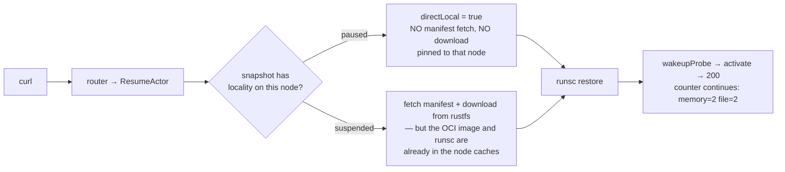

The counter demo's whole point is observable right here: with `preferredFidelity: SNAPSHOT_FIDELITY_MEMORY` **both** counters continue — the in-process one from the memory image, the file one from the restored `durableDir`. Drop to `VOLUMES` and only the file counter survives; the in-memory one restarts from a cold boot.

---

## Part 5 — The complete interaction map

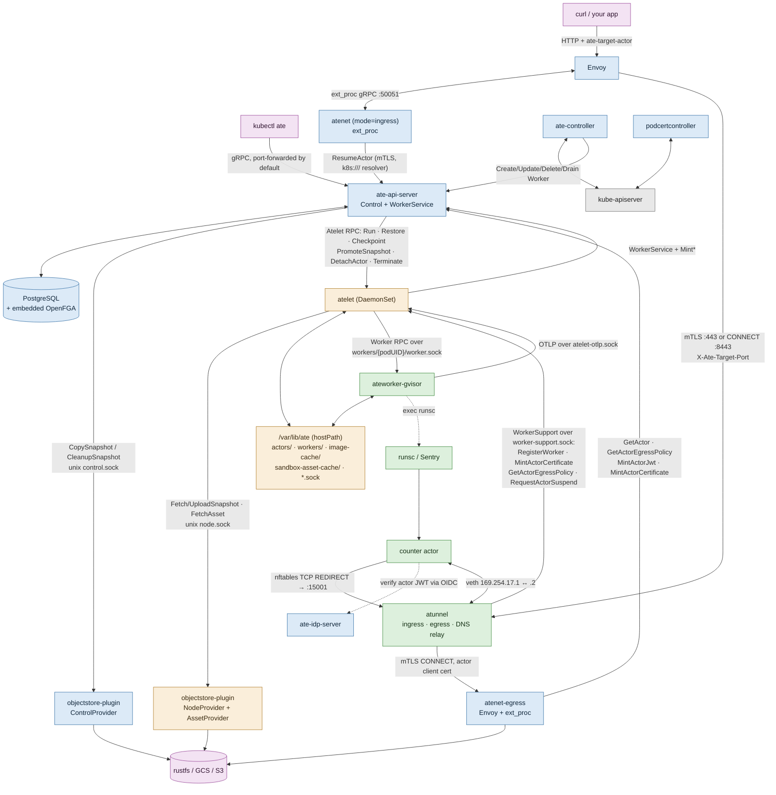

### Every socket and path, in one table

| Endpoint | Who serves | Who dials | Auth |
|---|---|---|---|
| `:443` gRPC | `ate-api-server` | `kubectl-ate`, `atenet-*`, `ate-controller`, `atelet` | mTLS pod cert **or** bearer JWT, then OpenFGA |
| `:21998` gRPC (hostPort) | `atelet` | `ate-api-server` | mTLS, pod-identity signer both ways |
| `/var/lib/ate/workers/<podUID>/worker.sock` | `ateworker` | `atelet` on the same node | unix socket under the shared hostPath |
| `/var/lib/ate/worker-support.sock` | `atelet` | `atunnel` in any worker pod on that node | mTLS; `atunnel` pins atelet's SPIFFE ID via `--atunnel-broker-identity` |
| `/var/lib/ate/atelet-otlp.sock` | `atelet` (OTLP relay) | every worker pod on the node | — (node-scoped; worker pods have **no** network path to the collector) |
| `/run/objectstore-plugin/node.sock` | plugin sidecar | `atelet` | pod-local emptyDir |
| `/run/objectstore-plugin/control.sock` | plugin sidecar | `ate-api-server` | pod-local emptyDir |
| worker pod `:443` | `atunnel` ingress | `atenet-router`'s Envoy | mTLS; atunnel checks the router's SPIFFE ID, the router checks `worker_spiffe_id` |
| worker pod `:8443` | `atunnel` CONNECT | `atenet-router` | same |
| actor netns `:15001` | `atunnel` egress | the actor, via nftables REDIRECT | transparent; `SO_ORIGINAL_DST` recovers the intended destination |
| `atenet-egress.ate-system.svc` | egress gateway | `atunnel` | mTLS; **per-actor client certificate** with the `ActorIdentity` extension |

### Who writes what

| Store | Written by |
|---|---|
| **etcd** (`WorkerPool`, `SandboxConfig`, `CSIDriverConfig`, Deployments, Pods, PodCertificateRequests, ClusterTrustBundles) | you, `ate-controller`, `podcertcontroller`, kubelet |
| **PostgreSQL** (Atespace, ActorTemplate, Actor, Tag, Worker, ActorAssignment, EgressPolicy, AccessPolicy, OpenFGA tuples, leases, worker_outbox) | `ate-api-server` **only** |
| **`/var/lib/ate`** (per-actor dirs, worker dirs, image cache, asset cache, local snapshots, sockets) | `atelet` and `ateworker` |
| **object storage** (snapshot manifests, memory images, durable-data tars) | the **objectstore-plugin sidecars only** — never a main process |

---

## Part 6 — Egress, when the actor calls out

The counter demo doesn't need this, but it's the other half of the actor's world.

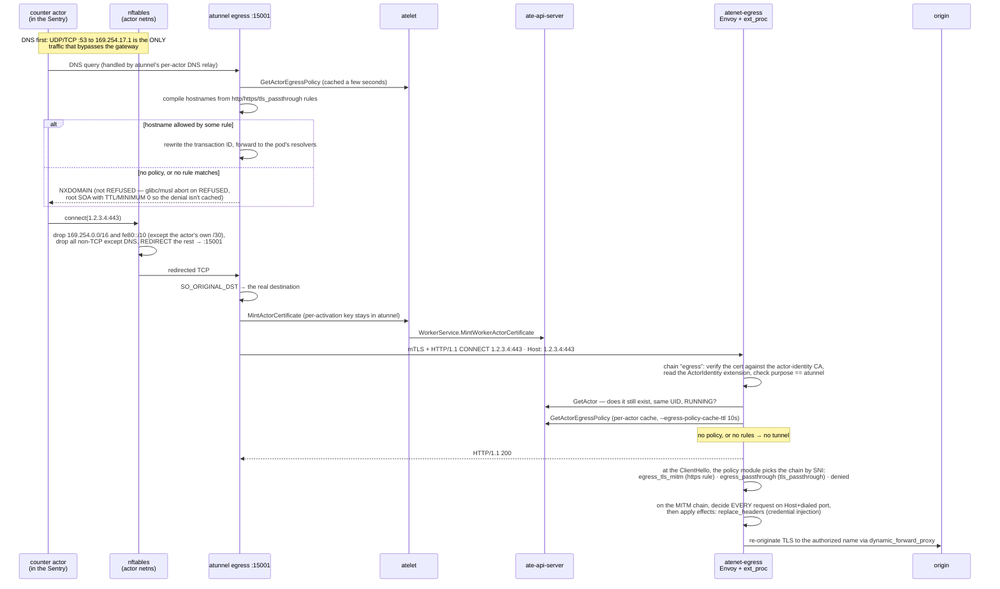

The four rules that define this boundary:

1. **Default deny.** No policy, or no matching rule → no tunnel, `403`, and `NXDOMAIN` for DNS.
2. **The actor is never trusted as a source of truth.** The gateway may use the actor-supplied hostname as a *policy input*, but when authorization is based on a hostname it **must route to that hostname** rather than use it to authorize an arbitrary IP from the CONNECT. Identity comes from `dev.ate.actor.identity`, set by the outer chain from the **verified peer certificate** — never from a header. "A callout without an identity is refused."
3. **The port a rule names is the port the actor dialed**, never a port in the request's `Host`.
4. **Credentials never enter the sandbox.** `replace_headers` runs on the MITM leg: the actor sends `Authorization: <placeholder>`, the gateway **discards the value** and substitutes a credential from the provider (or a freshly minted actor JWT). A request without the header is forwarded unchanged, so a credential reaches only the requests that ask for it.

`internal/egresspolicy` is shared between `ate-api-server` (which validates patterns at admission) and the gateway (which matches with them) — "so the two cannot drift."

---

## Part 7 — Debugging this on kind

```sh
# the control plane
kubectl -n ate-system get pods
kubectl -n ate-system logs deploy/ate-api-server -f
kubectl -n ate-system logs ds/atelet -f               # the node supervisor
kubectl -n ate-system logs deploy/atenet-router -c atenet-router -f
kubectl -n ate-system logs deploy/atenet-router -c envoy -f

# the worker pods, where an actor failure is almost always explained
kubectl -n ate-demo-counter get pods -l ate.dev/worker-pool
kubectl -n ate-demo-counter logs <worker-pod> -f       # includes the actor's own stdout/stderr,
                                                       # annotated with ate.* identity labels

# substrate's own resources
kubectl ate get atespaces
kubectl ate get actor-templates -a ate-demo-counter
kubectl ate get actor my-counter-1 -a ate-demo-counter -o yaml   # status.snapshots is the ground truth
kubectl ate get workers                                # and their capacity/allocated
kubectl ate list worker-actor-assignments --worker <name>

# the router's diagnostic page (loopback-only by default)
kubectl -n ate-system port-forward deploy/atenet-router 4040:4040
open http://127.0.0.1:4040/statusz        # flags, argv, last 100 queries, build tag; ?format=json

# traces, which show exactly which workflow steps ran vs fast-forwarded
kubectl port-forward -n otel-system svc/jaeger 16686:16686
kubectl ate get actor my-counter-1 -a ate-demo-counter --trace

# phase breakdowns
kubectl logs -n ate-system ds/atelet | grep "timing breakdown"
kubectl logs -n ate-demo-counter -l ate.dev/worker-pool | grep "timing breakdown"

# go all the way down: the shared hostPath, from inside the node
docker exec -it kind-control-plane ls -la /var/lib/ate
docker exec -it kind-control-plane ls -la /var/lib/ate/actors
docker exec -it kind-control-plane ls -la /var/lib/ate/workers
docker exec -it kind-control-plane ls /var/lib/ate/sandbox-asset-cache

# and see runsc actually running inside the worker pod
kubectl -n ate-demo-counter exec <worker-pod> -- ps aux | grep runsc
```

### Reading a trace

`step.skipped=true` + `step.skip_reason` on a span means a **re-entered workflow fast-forwarded** past work a previous attempt finished. That is normal and is the design. What you are looking for is the **first span that is not skipped** — that's where this attempt actually started doing work — and any span carrying an error, whose message is always `workflow failed at step <Name>: …`.

### The failure modes you will hit first on kind

| Symptom | Cause |
|---|---|
| nothing gets a certificate, install never comes up | the three feature gates missing — you created the cluster some other way than `hack/create-kind-cluster.sh` |
| pods stuck `ContainerCreating` on a dual/ipv6 run | a pre-existing v4-only `kind` Docker network; the script detects and recreates it, but only if nothing else is attached |
| `503 … no worker has room for the actor` | the pool is genuinely full. The router **parks** the request for `--parked-request-budget` (5 s) first, so a 503 means it stayed full for the whole budget. |
| `503 … router at capacity` | the parking lot (`--parked-request-max`, 1024) is full |
| actor template never gets a golden snapshot | read `status.goldenSnapshotStatus.error_message` — **nonempty is terminal**, it will not retry |
| `WorkerPool` has no Deployment | a sandbox class hasn't resolved. Check `status.sandboxClasses[].conditions` for `SandboxConfigNotFound` / `SandboxClassMismatch` / `DefaultConfigNotFound`, and `kubectl events --for workerpool/counter` |
| credential injection resolves nothing | the bundled `k8s.io` provider ships an **empty, default-deny** namespace policy. Grant each atespace its namespaces — `docs/egress-credential-injection.md#enable-it` |
| the actor can't reach anything, including its own OTLP collector | it has no `EgressPolicy`. Default deny is working as intended. |
| timeouts to sandboxes while the host is idle, `arp_cache: neighbor table overflow` in dmesg | the neighbor-table ceiling. `net.ipv4.neigh.default.gc_thresh1/2/3 = 4096/16384/32768` |
| `SandboxConfig` stuck `Terminating` | a `WorkerPool` still names it, **or** `ate-controller` isn't running (nothing will ever remove the protection finalizer) |
| a failed e2e run left namespaces behind | deliberate — the explanation is inside the worker pods, and deleting the namespace takes them with it. `hack/cleanup-e2e.sh` when you're done reading. |

### Micro-VM on kind

`hack/create-kind-cluster.sh` probes for `/dev/kvm` by running `docker run --rm --device /dev/kvm busybox true`, and only then bind-mounts `/dev/kvm` into the node and `chmod 666`s it. On macOS that means nested virtualization inside the Docker provider VM (Lima/Colima/Docker Desktop) — see `docs/dev/microvm-local.md`. Without KVM the cluster still works perfectly for gVisor.

```sh
KIND_CLUSTER_NAME=kind ./hack/run-microvm-demo-kind.sh
E2E_SANDBOX_CLASS=microvm hack/run-e2e-kind.sh -v -args --no-color
```

Note that micro-VM worker pods get `/dev/kvm` **from atelet's device plugin** (`internal/deviceplugin`, which advertises host device nodes to kubelet as extended resources), not from a privileged pod — so a worker is granted just those devices.

---

## Appendix — The exact `runsc` command lines

`cmd/ateworker-gvisor/runsc.go` builds every argv as:

```
<global flags> -root <actorDirs>/runsc-state <command> <subcommand flags> <extra args> [<container>]
```

The flags come from `internal_flags.json` in the worker image's `KO_DATA_PATH`, **hot-reloaded from a file watch** so they can be changed without rebuilding:

```json
{
  "globalFlags": ["-log-format", "json", "--alsologtostderr",
                  "--allow-suid", "--host-settings=ignore"],
  "commands": {
    "create":  {"globalFlags": ["--cpu-num-from-quota"]},
    "start":   {"globalFlags": ["-allow-connected-on-save"]},
    "restore": {"globalFlags": ["--cpu-num-from-quota"],
                "subcommandFlags": ["-background", "-detach"]},
    "delete":  {"subcommandFlags": ["-force"]},
    "list":    {"subcommandFlags": ["-quiet"]}
  }
}
```

So a cold boot of the counter actor is, in effect:

```sh
# the pause container — the sandbox root. It only reaps, so it gets
# no capabilities and mounts nothing (runsc.go: pauseContainer()).
runsc -log-format json --alsologtostderr --allow-suid --host-settings=ignore \
      --cpu-num-from-quota \
      -root /var/lib/ate/actors/<uid>/runsc-state create pause
runsc … -allow-connected-on-save -root … start pause

# then each application container
runsc … --cpu-num-from-quota -root … create counter
runsc … -allow-connected-on-save -root … start counter
```

and a resume replaces `create`+`start` with:

```sh
runsc … --cpu-num-from-quota -root … restore -background -detach \
      --image-path <restoreDir> counter
```

and a suspend is:

```sh
runsc … -root … checkpoint --image-path <checkpointDir> counter
runsc … -root … delete -force counter
```

Two flags worth knowing:

- **`-allow-connected-on-save`** — a workaround for a gVisor bug in networking resumption during checkpointing. `docs/architecture.md` notes the gVisor backend currently *requires* a `runsc` version that has it.
- **`--cpu-num-from-quota`** — this is how `ActorTemplate.resources.limits.cpu` becomes the **Sentry's vCPU count**, not just a cgroup quota. (`internal/sizing` writes the cgroup `cpu.max`/`memory.max` into the OCI spec, and also bounds the *virtual total memory the sandbox reports*, so a JVM or Go runtime inside doesn't size its heap from host RAM.)

There is also `runsc fscheckpoint`, used for filesystem-only captures.

### The sandbox record / snapshot manifest — one struct, two jobs

`cmd/atelet/sandbox_assets.go`, written as `manifest.json`:

```go
type sandboxAssetsRecord struct {
    SandboxClass          string                // "gvisor" | "microvm"
    Assets                map[string]assetEntry // name → {url, sha256}
    PauseImage            string                // gVisor only
    Atespace, ActorName, ActorUID             string
    ActorTemplateAtespace, ActorTemplateName  string
    SnapshotFiles         []string  // exactly what the worker reported writing
    DataSnapshotFiles     []string  // the subset that restores at VOLUMES on its own
    Fidelity              string    // "volumes" | "rootfs" | "memory"
}
```

It is **both** the per-actor on-node record (written at `Run`/`Restore`, read at `Checkpoint`) **and** the snapshot manifest (written at `Checkpoint`, read at `Restore`). The duality is deliberate:

- At `Checkpoint`, atelet **reads the on-node record** to recover the exact runtime version the actor started with, because the Checkpoint request no longer carries it — then pins that into the manifest, so **a restore always rebuilds the sandbox from the same binaries and pause image the snapshot was captured with**, even across a `SandboxConfig` upgrade.
- `SnapshotFiles` is the worker's own report rather than a hardcoded list, so the same code ships gVisor's image files and cloud-hypervisor's snapshot set without knowing either format.
- The actor identity fields make a flat snapshot **self-identifying** if control-plane persistence is ever unavailable.
- `Fidelity` is recorded so a snapshot's content is knowable **from the manifest alone**.
- At `Restore`, the manifest supplies only the files to restore and the identity — **the sandbox that runs the restored workload is the runtime the control plane assigned**, resolved through atelet's runtime index before any on-node work, so an invalid request changes nothing on disk. (And the manifest is what tells a *golden* restore from a *latest* one, which is why the restore metric's `kind` label can only be set after the manifest is read.)

Assets are keyed by name, not path, so `gvisor` (the release tarball, extracted so the `gvisor-bin/` helpers sit next to `runsc`) and the legacy bare-binary `runsc` asset both work, and a micro-VM record carries `cloud-hypervisor` + `kata-kernel` + `kata-image` through the same field.

---

## See also

- [architecture.md](architecture.md) — the component map and the two API surfaces
- [resource-model.md](resource-model.md) — what every noun means; fidelity, pause-vs-suspend, snapshot layout
- [control-plane.md](control-plane.md) — the workflow engine, scheduler, store, authz in depth
- [node-and-sandbox.md](node-and-sandbox.md) — atelet and both worker runtimes in depth
- [networking-and-egress.md](networking-and-egress.md) — the router, the egress gateway, atunnel, DNS
- In the repo: `demos/counter/README.md`, `docs/architecture.md`, `docs/dev/suspend-resume-phase-breakdown.md`, `docs/dev/microvm-local.md`, `internal/e2e/README.md`
