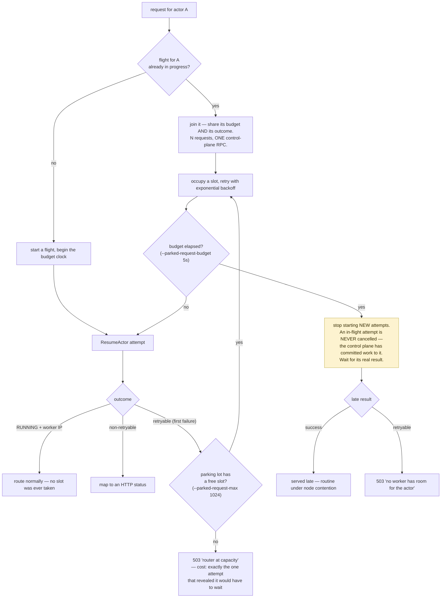
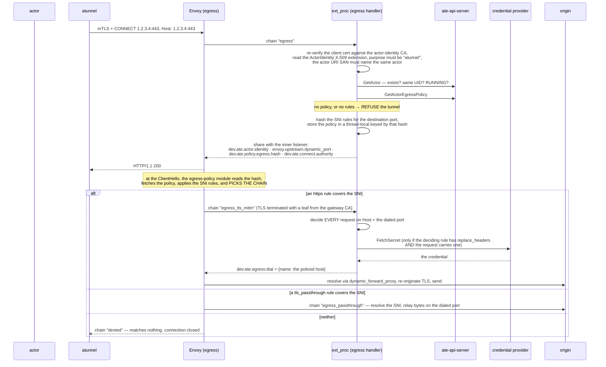

# Networking: Ingress Router, Egress Gateway, atunnel, DNS

An actor has **no pod IP, no cluster DNS, and no route to anything.** Its only interface is a point-to-point `/30` inside its own network namespace. Everything in and out goes through `atunnel`, which lives in the worker pod next to the sandbox. This page covers both directions.

Code: `cmd/atenet/` (the two gateways), `internal/atunnel/` (the in-worker tunnel), `internal/ateworker/actornet/` (the sandbox network), `internal/atenet/` (the shared header contract), `internal/egresspolicy/` (policy evaluation).

## The actor's network, exactly

```
actor netns                      gateway netns (per actor)       worker pod netns
┌──────────────────────┐        ┌───────────────────────────┐   ┌──────────────────┐
│ eth0  169.254.17.2/30│◄─veth─►│ atside 169.254.17.1/30    │   │ atunnel listeners│
│ default via .17.1    │        │  · atunnel egress :15001  │   │  · :443  ingress │
│                      │        │  · DNS relay :53 (UDP+TCP)│   │  · :8443 CONNECT │
│ nftables:            │        │  · ingress dial → .17.2:80│   │  · :15001 egress │
│  drop 169.254.0.0/16 │        └───────────────────────────┘   └──────────────────┘
│  drop fe80::/10      │          (169.254.17.0/30 is exempt
│  (except .17.0/30)   │           — it carries ingress, DNS,
│  drop non-TCP        │           and the wakeup probe)
│  except DNS :53      │
│  REDIRECT TCP→:15001 │
└──────────────────────┘
```

Constants in `internal/ateworker/actornet/net.go`:

```go
ActorVethName     = "eth0"
ActorVethGateway  = "169.254.17.1"
ActorVethIP       = "169.254.17.2"
ActorVethSubnet   = "169.254.17.0/30"
ActorHTTPUpstream = "http://169.254.17.2:80"
gatewayVethName   = "atside"
```

Two namespaces per actor: `nodepath.ActorNetNSName(actorUID)` (the sandbox's) and `SandboxGatewayNetNSName(actorUID)` = that `+ "-at"` (holding the veth peer and atunnel's per-actor sockets). Micro-VM shares one descriptor; gVisor uses two. Deleting the namespaces takes the veth pair with them.

**Actor networking is currently IPv4-only.**

### The nftables rules, and what each one is for

`internal/ateworker/actornet/sandbox.go`:

| Rule | Effect |
|---|---|
| drop `169.254.0.0/16` and `fe80::/10`, **but accept `169.254.17.0/30` first** | blocks cloud metadata services and link-local probing. The actor's own `/30` is exempt because *"that network carries actor ingress and DNS relay traffic"* (and the wakeup probe). |
| drop everything that is not TCP, except DNS on `:53` | **Packets are dropped, not rejected** — no ICMP port-unreachable, so the client hangs until its own timeout. |
| `prerouting` NAT chain: `ip daddr != 169.254.17.0/30 && l4proto == tcp` → `REDIRECT` to the egress port | transparent capture of all outbound TCP into atunnel |

`atunnel` recovers the original destination with `SO_ORIGINAL_DST` (`internal/linuxsys`). Localhost traffic stays inside the sandbox and never traverses the gateway.

`netns.Listen` opens the per-actor egress listeners **inside the gateway namespace**, and `egress.Proxy.Bind(actorUID)` is called **before anything is served** — *"so a connection accepted here cannot pick up a later activation's credentials."* That ordering is the whole guard against credential confusion across activations.

---

# Ingress

```sh
curl -X POST -H "ate-target-actor: <atespace>/<actor>" http://<router>/
```

## One binary, two deployments

`cmd/atenet` with a **required** `--mode`:

| `--mode` | ext_proc handlers | xDS server | Kubernetes access | Deployed as |
|---|---|---|---|---|
| `ingress` | ingress only | yes | yes | `atenet-router` |
| `egress` | egress only | no | **none** | `atenet-egress` |

**The mux refuses a direction this instance was not started to serve — a 404, not a fallback to the other handler**, "which would run the request through the wrong trust model."

`--atenet-dataplane` selects `envoy` (default) or `agentgateway`. With `agentgateway` the sidecar uses a static ConfigMap and atenet **does not start an xDS server**. Each gateway has its own static config because ingress and egress scale independently.

## The three ext_proc packages, and why they cannot import each other

`cmd/atenet/internal/router/`:

- **`extproc`** — the mux, and nothing else. Terminates the ext_proc stream, decides the direction, dispatches to the registered `Handler`, records latency and outcome. Owns the shared vocabulary (`RequestMetadata`, `Result`, `ReqError`). **It imports neither handler package.**
- **`ingress`** — resume, park, route to the actor's worker.
- **`egress`** — certificate-based actor-identity authentication and `EgressPolicy` enforcement.

The reason for the split is stated plainly: the two directions *"apply opposite trust models — egress derives the actor identity from a client certificate the gateway verified against the actor-identity CA, ingress treats every request header as unauthenticated client input — so the two are kept in separate packages that cannot reach into each other."*

**Direction is decided by the filter chain the dataplane says accepted the request** (`xds.filter_chain_name`, an Envoy attribute the egress gateway is configured to send) — **never by anything in the request itself**, so a client cannot pick the egress path by crafting one.

## Service ports

| Service port | Container port | Listener |
|---|---|---|
| 80 | 8080 | plaintext HTTP |
| 443 | 8443 | HTTPS |
| 8081 | 8081 | **CONNECT** (arbitrary-port ingress) |
| 8444 | 8444 | CONNECT over TLS |
| — | 50051 | ext_proc (atenet container) |
| — | 9090 / 9091 | Prometheus / health |
| — | 9902 | Envoy's own metrics |

## `HandleRequestHeaders`, step by step

`cmd/atenet/internal/router/ingress/ingress.go`:

1. **Extract trace context from the HTTP headers inside the `ProcessingRequest` payload** — not from the gRPC stream metadata. The code explains: *"The dataplane doesn't propagate trace context into the ext_proc gRPC stream's metadata — the per-request traceparent arrives in the HTTP headers carried inside the ProcessingRequest payload."* Get this wrong and your router spans are orphans.
2. `atenet.ParseTargetActor(...)` on the `ate-target-actor` header, or on the `dev.ate.actor.name`/`dev.ate.actor.atespace` filter-state attributes after CONNECT re-entry. Invalid → **404**.
3. Resolve `targetPort`: default **80**. After Envoy terminates CONNECT, the **outer** authority survives in filter state as `dev.ate.connect.authority` while `md.Host` belongs to the inner request — so the port is read from filter state, falling back to `md.Host` only when the method is literally `CONNECT`.
4. `h.resumer.ResumeActor(ctx, actorRef)` — the parking-aware resumer.
5. Take `worker_pod_ips[0]` and `worker_spiffe_id` from `status.workerAssignment`. **Missing SPIFFE ID or unparseable IP → 500**, because *"without the SPIFFE ID, atunnel's identity can't be checked."*
6. Build dynamic metadata `envoy.filters.listener.original_dst = {local: "<workerIP>:443", port: "<targetPort>", worker_spiffe_id: "..."}`. Envoy's `ORIGINAL_DST` cluster reads it.
7. **Overwrite the `ate-target-actor` header** with the resolved reference, *"so a client-provided value cannot select a different actor after this request has been resolved."*
8. Return the mutation + dynamic metadata, with `TemplateAtespace`/`TemplateName` attached as **low-cardinality** route-latency metric attributes.

### Why the port is a header but the address is metadata

The worker address rides in Envoy **dynamic metadata**. But `atunnel` is a separate process in the worker pod, not part of Envoy, and cannot read Envoy metadata — so **the actor's target port travels as a real header**, `X-Ate-Target-Port` (`internal/atunnel/ingress`), stripped before the request reaches the actor. That asymmetry is the reason both mechanisms exist, and it is easy to misread the code without it.

## Request parking

`docs/request-parking.md`, `ingress/{parking,resumer,flight}.go`. The scenario: in an oversubscribed system — *the core premise of Substrate* — a traffic burst momentarily exhausts the pool and `AssignWorker` returns `ResourceExhausted`. Failing fast would turn a sub-second blip into a user-visible error.

With parking on (**the default**), these are retryable: `ResourceExhausted`, `FailedPrecondition`, `Unavailable`, and `Aborted` (concurrent-resume conflict) — so a parked request rides out both pool saturation **and** control-plane blips like an ateapi rolling restart.



The subtleties that make this work, all from the doc:

- **A slot is taken only at the park transition** — the flight's *first retryable failure*. A request resolved on the first attempt (actor already running) **never occupies a slot**, so fast-path requests never compete with parked ones (#1081).
- **The budget bounds retries, not a committed resume.** Cancelling an in-flight attempt would discard an in-progress restore. The attempt is bounded by the control plane's own server-side RPC deadline; Envoy's ext_proc message timeout (`budget + 5s`) is the ceiling on how long a *client* is held.
- **The budget is per-flight, not per-request.** A request that joins a flight late may see `budget_exhausted` after waiting far less than a full budget — "the accepted cost of collapsing a hot actor's requests into one control-plane call."
- **Worst-case occupancy:** the resume attempt can outlive every caller; it carries no client-side deadline and runs to ateapi's server-side maximum, holding that actor's flight entry. New requests during that window join it rather than starting another call, and are ended by the dataplane timeout rather than a router verdict.
- **The ext_proc circuit breaker is the hard ceiling.** Every parked request holds one ext_proc stream for its whole wait, while an ordinary request holds one for a millisecond-scale header exchange. The router therefore **derives** `--extproc-max-requests` as `2 × --parked-request-max` (min 1024), so the lot always fits **and an equal share of fast-path headroom remains** — a saturated lot cannot starve requests to already-running actors, at any lot size. An explicit override is validated `>= --parked-request-max` at startup, *because a breaker below the lot would silently truncate it: Envoy would reject the overflow itself, with 503s that never reach the lot and never count in `parking.rejected`.*

Metrics: `atenet.router.parking.active` (gauge), `.wait.duration`, `.rejected`.

## Arbitrary-port ingress

The actor's default port is 80. To reach another, a client sends an HTTP `CONNECT` naming the port **in the authority** — not in a header or field:

```bash
curl --proxytunnel --proxy http://localhost:8001 \
  --proxy-header "ate-target-actor: my-atespace/my-actor" \
  http://actor-upstream:9090/
```

Note `--proxy-header`, not `-H`: the routing header goes on the **outer** CONNECT.

Envoy terminates the CONNECT on a dedicated listener (`connect_terminate`) and **re-injects the tunneled bytes into an internal listener** (`main_internal`) that runs the same ext_proc path as ordinary traffic. So **each request inside a long-lived tunnel still resumes the actor and re-routes independently if it moves workers.** The actor name, atespace and outer authority cross the re-entry as filter state.

**Only HTTP(S) over the tunnel is supported today** — raw TCP or other non-HTTP protocols on a non-default port are not yet reachable this way.

## Ingress client authentication

`--ingress-auth-mode`:

| Mode | Behavior |
|---|---|
| `static-mtls` | **No plaintext listeners at all.** Every client **must** present a SPIFFE certificate signed by `--ingress-client-ca-file`, whose ID is in `--ingress-allowed-spiffe-ids`. |
| `deprecated-insecure` (**the default**) | Offers both plaintext and secure listeners. A certificate is checked **only if the client presents one**; the plaintext listeners accept any client. |

> **The allowlist is the whole authorization policy: any listed client may reach any Actor.** Richer policies are post-GA. Install with `ate-setup --ingress-auth-mode=static-mtls` (kustomize component `manifests/ate-install/components/router-static-mtls`); the list lives in `manifests/ate-install/atenet-router.yaml`.

## The status page

Unauthenticated `/statusz`, bound to **`127.0.0.1:4040`** by default and **not published by the router Service**. Contents: global flag values, command-line args, the **last 100 queries served**, build tag. `?format=json` for machine reading.

```sh
kubectl -n ate-system port-forward deployment/atenet-router 4040:4040
```

> Binding `--status-address` to a non-loopback address exposes the diagnostic data to other pods.

Health checks are **separate**: `/healthz` (liveness) and `/readyz` (readiness) on `--health-listen-addr` (default `:9091`). For a GKE Gateway, migrate any `HealthCheckPolicy` from port 4040/`/statusz` to **9091/`/readyz`**, so draining pods also stop receiving traffic. GKE probes Pod IPs directly, so 9091 needn't be published by the Service.

## Graceful drain

The most elaborate in the system, because an abrupt restart would reset established connections and parked requests:

```
SIGTERM
  → flip /readyz to 503          (the Service stops sending new connections)
  → wait --drain-delay            (endpoint propagation)
  → drain the dataplane           (Envoy only, over its admin API;
                                   agentgateway manages its own termination)
  → gracefully stop ext_proc      (--drain-timeout, derived from the parking budget,
                                   so parked requests finish normally)
  → write a drain-complete marker on a pod-shared emptyDir
  → that marker releases the Envoy container's preStop hook
```

The whole sequence must fit inside `terminationGracePeriodSeconds`. An upgrade rolls the router as an ordinary Deployment update; **the drain lets each old pod's requests finish, except one still open about 15 seconds after the drain starts, which is cut.** Code: `drain.go`, `envoydrain.go`. Verify with `hack/verify-atenet-drain.sh`.

---

# atunnel (inside the worker pod)

`internal/atunnel/`, wired by `internal/ateworker/tunnel` — *"Both workers build their tunnel here so they cannot drift."*

| Listener | Flag | Default | Purpose |
|---|---|---|---|
| ingress HTTPS | `--atunnel-listen-address` | `:443` | mTLS from the router's Envoy |
| ingress CONNECT | `--atunnel-connect-listen-address` | `:8443` | mTLS CONNECT tunnel |
| egress | `--atunnel-egress-listen-address` | `0.0.0.0:15001` | target of the nftables redirect, bound **per actor inside its gateway netns** |

Every listen address is an unspecified wildcard, which Go binds as a dual-stack socket.

Identity flags:

| Flag | Default |
|---|---|
| `--atunnel-credential-bundle` / `--atunnel-trust-bundle` | `/run/podidentity.podcert.ate.dev/{credential-bundle,trust-bundle}.pem` |
| `--atunnel-client-identity` | the router's SPIFFE ID — **the only identity allowed to call actor ingress** |
| `--atunnel-broker-identity` | atelet's SPIFFE ID — **required on the credential-broker connection** |
| `--atunnel-egress-trust-bundle` | `/run/servicedns.podcert.ate.dev/trust-bundle.pem` — verifies the egress gateway |

## Ingress inside the worker

`internal/atunnel/ingress` is an HTTPS reverse proxy with a **per-actor activation table**. It:

- requires the router's SPIFFE ID on the client certificate;
- reads `X-Ate-Target-Port`, **strips it**, and rewrites the upstream port (`cfg.Upstream` is fixed for the Server's lifetime, so the header is what lets the port vary per request);
- dials the actor over the veth — `http://169.254.17.2:<port>`;
- detects gRPC properly (HTTP/2 framing + POST + `Content-Type: application/grpc`, which correctly **excludes gRPC-Web over HTTP/1.1**);
- returns **421 with `X-Ate-Assignment-Stale`** when the actor is no longer hosted here — the header exists to distinguish an atunnel routing rejection from a 421 the actor application itself returned.

Worker pod **port 80 is not an actor ingress path.**

## Egress inside the worker

`internal/atunnel/egress`: accept the redirected connection, recover the real destination with `SO_ORIGINAL_DST`, obtain a **per-actor client certificate** (private key generated at activation and never leaving atunnel; cert requested through atelet), and open an mTLS HTTP/1.1 `CONNECT` to the gateway with **both the request target and the `Host` header set to the original destination `IP:port`**.

## The DNS relay — the one thing that bypasses the gateway

`internal/atunnel/dns` (see its README). One `Relay` per ateworker holding the upstream resolvers (from the worker pod's `/etc/resolv.conf`), creating a per-actor `Server` with per-actor concurrency limits (`maxInFlightDNS`, `maxDNSConnections`).

**UDP** — two goroutines per `Server` plus a sweep ticker:
- *Ingress reader* reads from the actor-facing gateway `PacketConn`, validates, **rewrites the transaction ID to an allocated `upstreamID`**, records a pending entry, sends on the egress socket.
- *Egress reader* reads from an unconnected worker-namespace `PacketConn`, matches and validates against `pendingRequests`, then either fails over to the next upstream or restores `clientRequestID` and answers `clientAddr`.

The `upstreamID` rewrite exists to **avoid transaction-ID collisions across different actor source ports on the shared egress socket, and to prevent predictable upstream IDs.** Each pending entry keeps `QNAME`/`QTYPE`/`QCLASS` to validate that the response matches the query (**RFC 5452**), plus `upstreamIdx`/`deferredResp` for multi-upstream failover and an `expiry` for the sweep.

**TCP** — 2-byte big-endian length prefix per message (RFC 1035 §4.2.2); a dedicated upstream stream per connection with pipelining and out-of-order responses (RFC 7766 §6.2.1.1); two goroutines per accepted connection sharing a downstream write mutex; on client `EOF` the upstream write side is **half-closed (`CloseWrite`)** so in-flight pipelined responses finish draining.

**Validation decisions** (`validateRequest`):

| Outcome | When |
|---|---|
| **Drop** | packet < 12 bytes, or `QR == 1` (response bit on a query) |
| **`FORMERR`** (1) | malformed header/question, or `QDCOUNT != 1` |
| **`NOTIMP`** (4) | `OpCode != 0`, or a zone-transfer `QTYPE` (`AXFR`, `IXFR`) |
| **`NXDOMAIN`** (3) | **disallowed by the actor's egress policy** |

The `NXDOMAIN` choice is deliberate and worth remembering:

> *"`NXDOMAIN` rather than `REFUSED` so stub resolvers continue to the next `resolv.conf` search suffix; glibc and musl **abort** the lookup on `REFUSED`. The authority section carries a root `SOA` record with `TTL` and `MINIMUM` of 0, so resolvers do not cache the denial past a policy change (RFC 2308 §5)."*

**Policy enforcement:** since DNS bypasses the gateway, the relay enforces the policy itself. A `PolicySource` caches the actor's `EgressPolicy` for a few seconds — so a create/update/delete takes effect **without restarting the actor** (within ~5 s), and **keeps serving the stale cached entry if atelet is temporarily unreachable**. The compiled `*evaluator` is cached per `*ateletpb.EgressPolicy` pointer. Fetches use the `Server`'s context, so `Stop()` cancels one in progress.

---

# Egress

## The three legs

The egress gateway calls the same ext_proc sidecar from three Envoy filter chains, and the chain name (`xds.filter_chain_name`) tells the handler which leg it is on:

| Leg | Where | Sees | Decides |
|---|---|---|---|
| `egress` | the outer CONNECT | the actor certificate, the `IP:port` the actor dialed | **per TCP connection**: identity, and that the actor has a policy with rules |
| `egress_cleartext` | HTTP the actor sent in the clear | `Host`, method, headers, the dialed `IP:port` | **every request** — the `http` rules |
| `egress_tls_mitm` | TLS the gateway terminated | the same, plus the connection's SNI | **every request** — the `https` rules |

Plus `egress_passthrough` (relay bytes without decryption) and `denied` (matches no chain; the connection is closed).



### The dataplane attributes

Declared **once**, in `extproc/attributes.go`:

| Key | Direction | Carries |
|---|---|---|
| `dev.ate.actor.name` | ingress | the actor name across CONNECT re-entry |
| `dev.ate.actor.atespace` | ingress | the atespace across CONNECT re-entry |
| `dev.ate.connect.authority` | both | the outer CONNECT authority across re-entry: target-port selection on ingress, **the dialed port the egress request legs match `ports` against** |
| `dev.ate.actor.identity` | egress | the authenticated actor identity, to the policy ext_proc, the logs, and any additional ext_proc services |
| `dev.ate.egress:dial` | egress | **dynamic metadata** — a request leg's answer (`name` or `address`), which picks the route |
| `dev.ate.extproc.direction` | egress | selects the egress handler for dataplanes without Envoy filter chains |

Adding one takes four steps, and step 3 is the one people miss:

1. Declare the constant in `extproc/attributes.go`.
2. Set it in the dataplane.
3. **Ask for it.** ext_proc only receives the attributes named in its filter's `request_attributes`. *"A key that is set but not requested arrives as nothing at all, which reads the same as a key that was never set."*
4. Read it through `RequestMetadata.Attribute`.

**Naming:** a key Substrate owns is rooted at `dev.ate.` — `dev.ate.<area>.<thing>`, or `dev.ate.<thing>` with no area. *"A key someone else owns keeps **their** reverse-DNS root; do not re-home it under `dev.ate.` to make the set look uniform."* `xds.filter_chain_name` is Envoy's own and stays in Envoy's namespace. **"The prefix is a claim about who may rename the key, so getting it wrong means substrate is renaming something it does not own, or holding a name it never reserved."**

### Why per-tunnel isolation holds

> *"Envoy builds every inner connection from the filter state of the tunnel that created its pool, so `mitm_internal` keeps **one pool per downstream connection**, which on the HTTP/1 egress listener is **one per tunnel**: no tunnel inherits another's identity, authority or rules. Nothing inside the tunnel can write any of this; a callout without an identity is refused."*

### Ports

**The port a rule names, and the port the gateway dials, is the port the actor dialed — never a port in the request's `Host`.** The outer chain shares the CONNECT authority as `dev.ate.connect.authority`, and the request legs match `ports` against it. **A dataplane that does not share it gets no port enforcement.**

### Policy cache

Per-actor, `--egress-policy-cache-ttl` (default **10 s**, 0 disables). *"The TTL is exactly how stale a decision can be: a create, update or delete is visible to new requests within one TTL, and a deleted policy becomes a deny."* Every policy denial answers a fixed `egress denied` body; **the reason is only in the sidecar's log.**

## The EgressPolicy API

A singleton subresource of an Actor, named `default`. `rules` is an **unordered set of allows; traffic is denied when no rule matches.**

For a given destination name and port, **exactly one rule decides**, whatever its protocol. The tie-break, in order:

1. a matching hostname **without** a wildcard;
2. a matching **port number** rather than all ports.

Two rules with the same pattern on the same port, or both on all ports, are **rejected at admission.** The criteria apply within a protocol *and across* protocols that decide on the same input (an `https` and a `tls_passthrough` rule matching the same pattern). **Only the winning rule's effects are applied.**

| Rule | Protocol | Evaluated on | Notes |
|---|---|---|---|
| `http` | cleartext HTTP/1.1 and h2c (as gRPC uses) | the request authority + the dialed port | **TLS to these names is not allowed by this rule.** Defaults to port 80. |
| `https` | HTTPS, **intercepted (MITM)** | SNI + port at the ClientHello, then every request's authority | HTTP/1.1 and HTTP/2 inside; **HTTP/3 is not supported**. A connection with **no SNI does not match.** A non-HTTP protocol inside an intercepted connection **fails**. |
| `tls_passthrough` | TLS, **not decrypted** | SNI + port | the dialed address plays no part in the route |

**All of these are TCP. UDP is blocked. Protocols where the server sends first after connect are not supported.**

### Hostname patterns

A DNS name, or a DNS name with `*` as its **leftmost label**. Must be lowercase, RFC 1034/1123, no trailing dot.

- `*.example.com` matches **exactly one non-empty label** — `api.example.com`. It does **not** match `example.com` or `nested.api.example.com`.
- `*` alone matches every name.
- **No other wildcard syntax is accepted.** A pattern without a wildcard matches only the complete normalized name.
- Patterns may overlap; the rule ranks by the **most specific** pattern that matches.
- Internationalized names must be in **IDNA A-label (punycode)** form — no Unicode conversion is performed.
- Invalid: URLs, IP addresses, names with ports, malformed DNS names (`foo..example.com`), more than one trailing dot.

`internal/egresspolicy` is shared: `ate-api-server` validates patterns **with the same parser the gateway matches with**, "so the two cannot drift."

## Credential injection

`docs/egress-credential-injection.md`. Declared in a rule's `effects.replaceHeaders`:

```yaml
rules:
- https:
    hostnames: ["api.example.com"]
    effects:
      replaceHeaders:
      - header: Authorization
        prefix: "Bearer "
        credentialUri: ate-secret://k8s.io/default/ns1/example-api/token
```

The actor sends the header with **any placeholder value**; the gateway discards it and substitutes the credential. `prefix` is prepended **verbatim** — include the separator (`"Bearer "` with the trailing space). **A request without the header is forwarded unchanged, so a credential reaches only the requests that ask for it.** The placeholder itself is never inspected.

Header names must be unique **case-insensitively** (`+k8s:customUnique`), max 16 per rule.

The alternative source is `actorJwt`, which has the gateway **mint** a JWT for the actor (audiences, 300–3600 s lifetime). The gateway reuses a JWT across requests while enough lifetime remains, **so its `jti` does not identify a single request.**

### Credential URIs

`ate-secret://<provider-class>/<provider-specific-tail>` — the host names the provider that resolves it, the path is that provider's to interpret. A URI the provider refuses **denies the request with 403**.

- `k8s.io` — Kubernetes Secrets (`cmd/credential-provider/kubernetes-secrets`, the reference provider)
- `secretmanager.googleapis.com` — GCP Secret Manager (`internal/plugins/gcp-secret-manager`, its own Go module)

### Fail-closed behavior

| Situation | Outcome |
|---|---|
| decided by an `http`/`https` rule, carries the header, provider configured, resolves | header value replaced; request re-originated |
| does not carry the header | forwarded unchanged; **no credential fetched** |
| carries the header, **no provider configured** | **500** (Envoy) / **403** (agentgateway) |
| secret missing, or the namespace not authorized for the atespace | **403** |
| provider unreachable or timed out | **503** (fail closed, retryable) |
| provider returns an empty credential, or one with control characters | **503** |
| URI names an unserved provider class; unusable header name; unparseable URI | **500** / **403** |

> *"On an HTTP or HTTPS request that carries it, **any** failure to produce the credential, including having no provider, denies the request rather than letting it out without the credential."*

**The provider is the only component in the path with access to secret storage — the gateway never reads secrets at rest.**

The bundled `k8s.io` provider ships with an **empty, default-deny namespace policy**: it resolves nothing until a cluster admin grants each atespace the namespaces whose Secrets it may read. This is the single most common "why isn't injection working" cause.

A caveat the API records about `http` rules: replacement is supported on HTTP as well as HTTPS, **but on HTTP the gateway does not originate TLS to the destination** — observers can read the credential and on-path attackers can modify the request. Policy authors must account for any unprotected segment between injection and the destination.

## MITM requires the actor to trust the gateway CA

`docs/egress-trust-bundle.md`. The gateway mints server certificates **on the fly from a built-in CA**, so an `https` rule only works if the code inside the actor trusts that CA. Substrate injects the anchors with a `systemInfo` volume:

```yaml
volumes:
- name: system-info
  systemInfo:
    dataSources:
    - trustBundle:
        names:
        - egress-mitm.ate.dev      # the MITM CA
        - system-roots.ate.dev     # standard public WebPKI
```

Listing both means the same bundle works for `https` rules, `tls_passthrough` rules, or a mix. `internal/pemutil` sanitizes the bundle the way kubelet does for projected `clusterTrustBundle` volumes. `ate-controller`'s `EgressMITMTrustReconciler` maintains the cluster side.

Without it, TLS to a MITM'd name simply fails inside the actor — which looks like a network problem and is actually a trust problem.

## The network egress contract

`docs/network-egress.md` states what any replacement PEP **MUST** do. The core of it:

> *"The egress PEP MUST NOT trust any decision or attestation coming from the actor itself; it MUST instead trust only information carried through substrate-controlled channels (e.g. the actor certificate and the CONNECT request produced by atunnel). For example, the PEP MUST NOT treat an actor-provided HTTP hostname or TLS SNI as proof that the original destination has that name. The PEP MAY use the hostname as a policy input, but when authorization is based on that hostname, it MUST **route the traffic to the authorized hostname** rather than use the hostname to authorize an arbitrary IP address from the CONNECT request."*

Server side: the PEP must serve TLS with a certificate valid for its configured hostname, chaining to a CA `atunnel` trusts; `atunnel` uses that hostname as the TLS server name and **rejects** a connection it cannot verify. In the default deployment the PEP gets its certificate from a projected `podCertificate` volume using the **service-DNS signer** — which derives DNS SANs from the Services selecting the pod, so **the PEP must be selected by a Service** and the hostname in `atunnel` must match one of those names (`atenet-egress.ate-system.svc`).

Client side: the PEP must require and verify the client certificate before accepting a CONNECT — verify the chain and lifetime against the Actor Identity CA, require client-auth usage, require **exactly one** valid `ActorIdentity` extension with atespace + name + UID + purpose present, require `purpose == atunnel`, require the actor URI SAN to name the same actor — **and then confirm with `ate-api-server` that the actor still exists, its current UID matches the certificate, and it is running.** Any failure → reject.

The extension OID is `1.3.6.1.4.1.11129.2.12.2`, allocated under Google's enterprise number, and **will change after the CNCF donation is complete.**

Before traffic reaches the PEP, ateworker drops IPv4 `169.254.0.0/16` and IPv6 `fe80::/10`, with `169.254.17.0/30` exempt.

## The supported-traffic table (GA scope)

`docs/egress-traffic.md`:

### TCP

| Port | Traffic | Behavior | What the actor sees when refused |
|---|---|---|---|
| any | HTTP(S) 1.1 / 2 | **supported with policy controls** | `403 Forbidden` |
| any | WebSocket | **blocked** | `403 Forbidden` |
| any | standard HTTP(S) CONNECT (forward-proxy) | **blocked** | `403 Forbidden` |
| 53 | DNS to the sandbox gateway | allowed for hostnames in the policy | `NXDOMAIN` |
| any | **any other TCP** | **blocked** | the connection is **accepted and then closed with no bytes returned.** No status code. atunnel logs the failure. |

### UDP

| Port | Behavior | Refused |
|---|---|---|
| 53 | allowed for policy-matching hostnames | `NXDOMAIN` |
| any other | **blocked** | **packets dropped, not rejected** — no ICMP port-unreachable, so the client hangs until its own timeout |

Everything that is neither TCP nor UDP is blocked, also by dropping.

**This applies to the actor's own telemetry too.** An OpenTelemetry SDK inside an actor cannot reach the collector until the actor has an `http` egress rule for it. This surprises people — see `docs/observability.md#actor-telemetry-needs-an-egress-policy`.

## Where to read more

- `cmd/atenet/internal/router/README.md` — **the best single document in the repo** on this subject: responsibilities, the package split, the egress-legs table, the attribute table, the naming rules, the modes, the status page.
- `cmd/atenet/README.md` — the deployment model and the drain contract.
- `internal/atunnel/dns/README.md` — the DNS relay in full.
- `docs/network-egress.md` — the PEP contract and the ASCII path diagram.
- `docs/egress-traffic.md`, `docs/egress-credential-injection.md`, `docs/egress-trust-bundle.md`.
- `docs/request-parking.md`.
- `cmd/atenet/internal/router/xds.go` — the Envoy configuration (67k, with a 65k test). The listener names to look for: `connect_terminate`, `main_internal`, `mitm_internal`.
- `docs/dev/mitm-egress-test-runbook.md`, `hack/setup-e2e-egress-tls-kind.sh`, `hack/verify-egress-demo.sh`.
