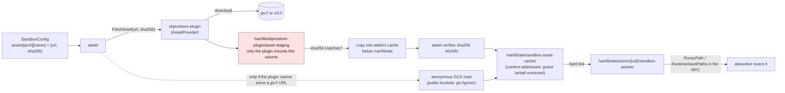

# The Node: atelet, ateworker, and the Two Sandbox Runtimes

Everything that happens on a node. `atelet` (a DaemonSet) is the node supervisor; `ateworker-gvisor` / `ateworker-microvm` run **inside** each worker pod and drive the actual sandbox. They find each other through one shared hostPath.

For the end-to-end narrative, read [end-to-end-on-kind.md](end-to-end-on-kind.md) first. This page is the reference.

## The privilege split, which explains the whole design

| | `atelet` | `ateworker` |
|---|---|---|
| Runs as | DaemonSet pod, one per node | a container **inside every worker pod** |
| Capabilities | drop `ALL`, add **`DAC_OVERRIDE` only** | drop `ALL`, add 13 (gVisor) or 15 (micro-VM). **Not privileged.** |
| Does | image pulls, layer unpacking, asset fetching, snapshot movement, OCI bundle assembly, CSI volume attach | **every mount, netlink, device and namespace operation**, and exec'ing the sandbox runtime |
| Object storage | **none** — no SDK linked, no credentials | none |
| Lifetime | the node | the worker pod |

The one capability atelet holds is there for exactly one thing, and the manifest says so: *"CAP_DAC_OVERRIDE is for one thing: emptying a directory a non-root actor created in its 0777 durable dir. It is owned by the actor's uid, typically 0755, so root has no write access to it and `resetActorDirs` fails after every checkpoint."*

This split is why `internal/imagecache` is divided the way it is:

- **atelet** (plain root, all caps dropped) pulls layers and unpacks them into the pool, and writes a `rootfs-overlay.json` into each bundle. **Whiteout entries are recorded in per-layer metadata rather than materialized**, because overlayfs whiteouts are char devices (needs `CAP_MKNOD`) with `trusted.*` xattrs for opaque dirs (needs `CAP_SYS_ADMIN`) — neither of which atelet has.
- **ateworker** (which already owns every mount in its pod) **finalizes** layers — materializing the recorded whiteout state, once per layer — and mounts the overlay rootfs just before `runsc create` or staging the micro-VM virtio-fs lower.

## `/var/lib/ate` — the shared contract

`internal/nodepath.BasePath = "/var/lib/ate"`, a `hostPath` mounted **at the same path** into atelet and every worker pod. Same absolute path on both sides is the whole point: a hard link atelet makes is a file the worker can exec, and a directory path atelet puts in an RPC resolves in the worker.

```
/var/lib/ate/
├── actors/<actorUID>/                 # per-actor, atelet creates, worker consumes
│   ├── sandbox-assets/                #   hard links into the asset cache — the ONLY
│   │                                  #   place a worker runs a sandbox binary from
│   ├── oci-bundle/                    #   per-container bundles + rootfs-overlay.json
│   ├── checkpoint/                    #   where the worker writes a new checkpoint
│   ├── restore/                       #   staged files for a restore
│   ├── durabledir-volume-mounts/
│   ├── systeminfo-volume-roots/
│   ├── external-volume-mounts/        #   CSI
│   └── runsc-state/                   #   runsc -root
├── workers/<podUID>/
│   ├── worker.sock                    # ateworker's gRPC; atelet dials it
│   └── sandbox-runtimes.json          # atelet writes; the worker file-watches it
├── image-cache/                       # content-addressed unpacked layers
│   ├── version
│   └── layers/sha256/<diffid>/{fs/, whiteouts.json, finalized}
├── sandbox-asset-cache/               # content-addressed sandbox assets (runsc, kernels)
├── sandbox-asset-scratch/             # short-lived download destinations
├── snapshot-scratch/                  # short-lived manifest dirs (inside the plugin's root)
├── sandbox-runtime-index.json         # which runtimes this node's workers advertise
├── worker-support.sock                # atelet serves WorkerSupport to in-pod atunnel
└── atelet-otlp.sock                   # atelet's OTLP relay, node-scoped
```

Both sides derive `ActorSandboxAssetsDir` from the actor UID, so **a worker can verify that the directory a request names is that actor's own.**

Two honest caveats the code records about this mount: `BasePath` is mounted **writable** and shared with `worker-support.sock`, the OTLP socket and the image cache, so a worker pod can unlink or replace an atelet-owned socket. Confining atelet-owned sockets to a read-only subdirectory would need its own volume and mount, and the pod keeps `CAP_SYS_ADMIN` anyway — tracked separately rather than papered over.

The **version-skew rule for this layout** (`docs/version-skew-policy.md`): what N writes, N+1 can read, **and what N+1 writes, N can read.** So a layout change takes two releases — N+1 reads old and new but still writes old; N+2 writes new. That is what keeps a rollback possible. atelet passes the per-actor directories to ateworker **in the RPC**, so only atelet knows the layout.

## The atelet gRPC surface

`internal/proto/ateletpb/atelet.proto`. Two services:

### `Atelet` — called by `ate-api-server`

| RPC | What it does |
|---|---|
| `Run` | create a new containerized workload from scratch (a cold boot) |
| `Checkpoint` | capture the workload as a new snapshot and **return the worker to a blank state**. `upload_config` says when it becomes durable. |
| `Restore` | restore a workload from a snapshot onto a worker |
| `PromoteSnapshot` | make a snapshot durable **while keeping its local copy** — used to tag a paused actor's snapshot without evicting it from the node. Idempotent: once durable, answers from the manifest at `snapshot.object`. |
| `DetachActor` | make the latest local snapshot durable, then **delete the local snapshots**, so the actor can resume on any node. atelet also does this on its own after `--snapshot-detach-delay`. **Currently returns `UNIMPLEMENTED`.** |
| `Terminate` | kill any running workload, unmount volumes, clean up node state. Tolerates a nil spec: the delete flow terminates template-less actors with a fallback spec. |

`Checkpoint`'s contract is worth reading in full, because the ordering is load-bearing:

> Once the worker has captured the workload, and **before** the new snapshot is uploaded or stored locally, atelet deletes the actor's older local snapshots — except one still being uploaded, which it deletes when that upload ends. A `Checkpoint` that then fails to upload or store the new snapshot **leaves the actor with no local snapshot.**

`DetachActor` returns `ABORTED` while a Run/Restore/Checkpoint is in progress or the actor runs on this node, and `FAILED_PRECONDITION` when the latest local snapshot cannot be made durable (e.g. it has no `snapshot.object`).

### `WorkerSupport` — called by in-pod `atunnel` over `worker-support.sock`

| RPC | Purpose |
|---|---|
| `RegisterWorker` | the worker reports capacity + sandbox runtimes; atelet forwards to `ate-api-server` |
| `MintActorCertificate` | the per-actor egress client certificate |
| `RequestActorSuspend` | **the worker asks the control plane to suspend an actor it hosts** |
| `GetActorEgressPolicy` | the policy atunnel's DNS relay enforces |

`internal/ateworker/suspend`'s package doc explains the inversion: *"This is the upward half of a suspend: the request travels worker → atelet → ateapi, and the suspend the control plane decides to run travels back down the ordinary path as a `Checkpoint` into the worker that asked."*

`internal/ateletdial` authenticates both ends by **pod certificate**. atunnel pins atelet's SPIFFE ID with `--atunnel-broker-identity`.

## The `ateworker` gRPC surface

`internal/proto/ateworkerpb/ateworker.proto`, served on `workers/<podUID>/worker.sock`:

`RunWorkload`, `CheckpointWorkload`, `RestoreWorkload`, `TerminateWorkload`, `GetWorkloadStats`, `GetActiveWorkloadStats`.

**`internal/ateworkervalidation` is a separate package** — unlike `controlapi`, where the generated validation lives with the handlers — specifically because both worker binaries implement the service in package `main` and generated code cannot be shared from there.

## What atelet does continuously

### `worker_sandbox_syncer.go` — keeping each worker's runtime file current

Reads the Pod, WorkerPool and SandboxConfig informers; for each worker pod UID on this node, writes `workers/<podUID>/sandbox-runtimes.json` (or removes the directory once the pod is gone).

- **Queue key is the pod UID**, not `namespace/name`, because worker directories are named by UID — and a directory left on disk is all the syncer has of a pod that is gone.
- **Enqueue jitter** (`syncMaxJitter`) spreads the fleet's rewrites: every atelet observes a `WorkerPool`/`SandboxConfig` change within about a second, and **each rewrite makes its worker register again**, so without jitter the whole fleet hits `ate-api-server` at once. Applied as the enqueue delay, so duplicate events inside the window collapse.
- Orphan directories found at startup are left alone until `orphanMinAge` (1 minute), covering a worker that made its own directory before its pod reached atelet's cache.
- Retries are capped at `syncMaxRetries` while the pool's `SandboxConfig` is unresolved.

### `runtime_prewarm.go` — fetching assets before first use

As the syncer plans each worker, atelet prewarms its default sandbox runtime: fetch the assets, pull the pause image. One worker drains the queue, so each attempt is bounded at **10 minutes** (`defaultPrewarmAttemptTimeout`) — an attempt that never returned would block every other runtime's prewarm. `prewarmMaxRetries = 8` with backoff capped at 5 minutes covers transient bucket/registry outages of several minutes without hammering a permanently broken runtime forever. **First use remains the correctness path**; prewarm is pure latency.

### `snapshottracker` — local snapshots and background detach

Tracks each actor's snapshots on this node and detaches them in the background after `--snapshot-detach-delay`.

The critical-section API is what keeps the races out:

- `BeginStart(actorUID)` — a `Restore` waits out an in-flight detach; with the local copy then gone, the restore reads `snapshot.object`.
- `BeginCheckpoint(actorUID)` — a detach in progress finishes first, and none starts until the checkpoint returns, **so a detach cannot delete the snapshot being written**.
- `ForgetLocal` / `CommitLocal` / `CommitDurable` / `PruneLocalCheckpoints`.

`UploadLocalSnapshot` is idempotent in a specific way: with the local copy gone, it **succeeds without uploading if a manifest is already committed at the URI**, and reports whether it actually uploaded.

### `statspoller.go` — per-actor usage sampling

`--actor-stats-poll-interval` (default 1 min, 0 disables) polls each worker's `GetActiveWorkloadStats` and emits `ate.actor.stats.*` and the `ate.actor.usage_sampled` events. `internal/workerstats` holds the shared attribution and sampler both runtimes use.

### `imagegc.go`

Garbage-collects the node image cache.

### `otlprelay`

atelet serves OTLP on `atelet-otlp.sock` and forwards to `OTEL_EXPORTER_OTLP_ENDPOINT`, **so a worker pod needs no network path of its own to export telemetry.** It is node-scoped rather than per-pod because atelet is a DaemonSet, so one socket collapses N per-pod collector connections into one per-node connection.

## The snapshot manifest / sandbox record

`cmd/atelet/sandbox_assets.go`. One struct, written as `manifest.json`, that is **both** the per-actor on-node record (written at `Run`/`Restore`, read at `Checkpoint`) **and** the snapshot manifest (written at `Checkpoint`, read at `Restore`).

```go
type sandboxAssetsRecord struct {
    SandboxClass          string                // "gvisor" | "microvm"
    Assets                map[string]assetEntry // name → {url, sha256}
    PauseImage            string                // gVisor only
    Atespace, ActorName, ActorUID             string
    ActorTemplateAtespace, ActorTemplateName  string
    SnapshotFiles         []string  // exactly what the worker reported writing
    DataSnapshotFiles     []string  // the subset that restores at VOLUMES on its own
    Fidelity              string    // "volumes" | "rootfs" | "memory"
}
```

Why each piece is there:

- `PauseImage` *"is recorded here rather than taken from the request at Restore so a snapshot is rebuilt with the same sandbox it was captured from."*
- Actor identity *"makes a flat snapshot self-identifying if control-plane persistence is unavailable."*
- `SnapshotFiles` is **the worker's own report**, not a hardcoded list, *"so we ship precisely that set (gVisor's image files, cloud-hypervisor's snapshot set, …)"* — the same atelet code handles both formats without knowing either.
- `Fidelity` is recorded *"so a snapshot's content is knowable from the manifest alone."*
- At `Checkpoint`, atelet reads the **on-node** record to recover the runtime version the actor started with, because the request no longer carries it, and pins that into the manifest.
- At `Restore`, the manifest supplies only files + identity; **the sandbox that runs the restored workload is the runtime the control plane assigned**, resolved through atelet's runtime index *before any on-node work* so an invalid request changes nothing on disk. (The manifest is also what tells a *golden* restore from a *latest* one, which is why the restore metric's `kind` label can only be set after the manifest is read.)

**Version-skew rule for manifests:** within a major, a release reads what any earlier release of that major wrote, and **a release ignores manifest fields it does not know** — so a snapshot taken at N+1 still restores after a rollback to N. A new field must be safe to ignore.

## Sandbox assets: the trust chain



Properties that make this safe:

- **The plugin holds the credentials; atelet holds none.** atelet has no object-storage settings of its own.
- The staging volume is mounted **only by the plugin**, *"so atelet never sees bytes it did not pin."*
- The sha256 is verified by the plugin **and again** by atelet.
- The plugin **refuses any URL under a snapshot location**, and the in-tree plugin serves only its backend's scheme (`gs://` on GCS, `s3://` on S3).
- `maxAssetBytes` caps a download at **8 GiB**; `--asset-staging-capacity` (8 Gi, volume `sizeLimit` 9 Gi) bounds the staging area, because kubelet evicts the pod if the volume exceeds it.
- The sha256 both **names the cached file** (so two configs naming the same content share it, and two different contents cannot collide) and verifies integrity.
- Assets are keyed **by name, not path**, so `gvisor` (release tarball) and legacy `runsc` (bare binary) both work, and a micro-VM record carries `cloud-hypervisor` + `kata-kernel` + `kata-image` through the same field.

---

# Runtime 1: gVisor (`ateworker-gvisor`)

The default. Runs each actor under `runsc`.

## No RuntimeClass. gVisor is nested inside a runc pod.

There is **no `RuntimeClass` in this repository and nothing sets `pod.spec.runtimeClassName`.** The worker pod is started by containerd + runc like any other pod; `ateworker-gvisor` **execs `runsc` as a child process** from the hard-linked asset in `/var/lib/ate/actors/<uid>/sandbox-assets/`.

The conventional deployment — a containerd runtime handler plus a `RuntimeClass` — would make the sandbox lifecycle *be* the pod lifecycle, which is exactly what Substrate exists to decouple.

## The command lines

`cmd/ateworker-gvisor/runsc.go` builds every argv as:

```
<global flags> -root <actorDirs>/runsc-state <command> <subcommand flags> <extra args> [<container>]
```

Flags come from `internal_flags.json` in the image's `KO_DATA_PATH`, held in a `flagStore` behind a lock and **hot-reloaded from a file watch**, so no file I/O happens on the hot path and the flags can change without a rebuild. `parseFlagConfig` uses `DisallowUnknownFields` and rejects trailing data.

```json
{
  "globalFlags": ["-log-format", "json", "--alsologtostderr",
                  "--allow-suid", "--host-settings=ignore"],
  "commands": {
    "create":  {"globalFlags": ["--cpu-num-from-quota"]},
    "start":   {"globalFlags": ["-allow-connected-on-save"]},
    "restore": {"globalFlags": ["--cpu-num-from-quota"],
                "subcommandFlags": ["-background", "-detach"]},
    "delete":  {"subcommandFlags": ["-force"]},
    "list":    {"subcommandFlags": ["-quiet"]}
  }
}
```

Commands wrapped: `create`, `start`, `checkpoint`, `fscheckpoint`, `restore`, `delete`, `state`, `list`, `kill`, `wait`. The `*Args` builders (`checkpointArgs`, `fsCheckpointArgs`, `restoreArgs`) are factored out **specifically so argument construction is unit-testable without executing runsc.**

Two flags to remember:

- **`-allow-connected-on-save`** — a workaround for a gVisor bug in networking resumption during checkpointing. `docs/architecture.md` notes the gVisor backend currently *requires* a `runsc` version that has it.
- **`--cpu-num-from-quota`** — this is how `ActorTemplate.resources.limits.cpu` becomes the **Sentry's vCPU count**, not merely a cgroup quota.

## The pause container

```go
// pauseContainer is the sandbox root container. It only reaps, so it gets no
// capabilities and mounts nothing.
```

It holds the sandbox's namespaces and runs `/pause`. Its image comes from the `SandboxConfig` version's `pauseImage` (required for gVisor, forbidden for micro-VM, which runs no pause container) and is **pinned into the snapshot manifest** so a restore re-creates the sandbox from the same image.

The type carries a TODO to drop it once gVisor can run without one (gvisor PR #13981).

## Restore phases

`cmd/ateworker-gvisor/phaselog.go`. Every phase is sequential, so they partition the total up to a few microseconds:

```
prep → egress_prepare → net_setup
     → pause_rootfs → pause_create → pause_restore
     → app_rootfs → app_create → app_restore
     → wakeup_probe → activate → total
```

The `app_*` phases are **sums over the application containers** (restored one after another), and the container count rides along on the record as `ate.actor.container.count` *"so a reader can divide."*

Checkpoint phases: `prep → checkpoint → durable_dir → teardown → total`. A `Full` scope runs `checkpoint`; a `Data` scope runs `durable_dir` capture instead. Under a Data scope, `pause_restore` and `app_restore` time the **cold start that stands in for the restore.**

> These names are deliberately **kept out of `internal/ateattr`**: that package's `SnapshotPhase*` values are the `ate.snapshot.phase` metric enum, and these are not values of it. Only `total` is shared, so the two layers' records agree on the denominator.

## PID 1

`internal/ateworker/pid1` — and its doc comment is the clearest statement of a subtle bug class:

> PID 1 inherits every orphan (e.g. the runsc sandbox once `runsc create` exits) and must reap them with `wait4(-1)`, which **races `os/exec` for the exit status of the worker's own subprocesses**. The init re-executes the binary as its only child, reaps everything, and exits with the child's status.

So the worker binary runs twice: once as a minimal init, once as the service.

## Other gVisor-specific files

| File | What |
|---|---|
| `ckptcgroup.go` | per-checkpoint cgroup handling |
| `internal/cgroupstats/` | reads cgroup stats for `GetWorkloadStats` |
| `internal/cdiinject/` | Container Device Interface injection (`inject.go`, `soname.go`) |
| `sandboxexit.go` | detects and classifies sandbox exits |
| `sandboxnet.go`, `durable.go`, `actorpath.go`, `stats.go`, `hosted.go` | networking, durable volumes, paths, stats, the per-actor hosting table |
| `main_unsupported.go` | the non-Linux build stub |

---

# Runtime 2: micro-VM (`ateworker-microvm`)

A **Kata guest on Cloud Hypervisor**, without the kata shim.

> *"ateworker boots cloud-hypervisor itself (see `internal/ch`), then drives the stock kata-agent over its hybrid-vsock ttrpc API to create the sandbox and run each container on its host-merged rootfs."*

## The division of labour

| Operation | Who drives it |
|---|---|
| **Run** (boot the VM + run the OCI container) | **kata** (`internal/kata`) — `DialAgent`/`AgentClient` over hybrid-vsock ttrpc |
| **Suspend** (pause + snapshot) | **ateworker**, driving the CH REST API underneath (`internal/ch`) |
| **Restore** | **ateworker**, with a bare-CH relaunch (`ch.LaunchVMM` + `RestoreWithNetFDs`) |

`internal/kata` also owns the guest `kernel_params` and default guest sizing (`config.go`), and sweeps leftover per-sandbox host state (`CleanupSandboxState`). The per-sandbox runtime dir follows kata's convention `/run/vc/vm/<id>/`, holding `clh-api.sock` and the hybrid-vsock socket.

## Host-side rootfs overlay — the key architectural difference

`cmd/ateworker-microvm/rootfsupper.go`. Each container's rootfs is assembled **on the host** — the stock kata arrangement: `overlay(lower = the OCI image bundle, upper/work = a per-actor directory)`, merged by the host kernel and served to the guest over **the one `kataShared` virtio-fs share**.

Consequences:

- **Rootfs writes cost host disk (reclaimable page cache), not guest RAM.** This is what makes `ROOTFS` fidelity possible on this class and not on gVisor.
- The **host kernel owns all overlay mechanics**, so deletion metadata is the canonical kind: whiteouts as `0:0` char devices, opaque markers as `trusted.overlay.*` xattrs in the upper — no special mount options, no guest xattr passthrough.
- The upper directory is owned **entirely by ateworker** (atelet never touches it): created pristine at cold boot, re-materialized from the snapshot at restore, removed at teardown *after* `CleanupSandboxState` has dropped the overlay mounts using it.
- `ROOTFS` and `MEMORY` snapshots ship the upper as **one tar per container** (`rootfsUpperTarFile`), taken while the guest is paused — *"the share is write-through, so a paused guest's completed writes are already in the upper."*
- Each tar holds **only the contents** of that container's upperdir: ateworker creates the directory layout itself on restore, *"so nothing in the snapshot decides a path ateworker later mounts or wipes."*
- A `ROOTFS` restore puts the upper back and **cold-boots on it**. A `VOLUMES` snapshot deliberately excludes rootfs state, so the workload cold-starts on a pristine upper.

The comment also records the two retired alternatives, which is useful history: *a guest tmpfs upper capped rootfs writes at the tmpfs size and pinned every written byte in guest memory; a guest-mounted overlay on a virtio-fs upper needed three kernel workarounds.* Snapshots from the tmpfs era still restore.

Because `DurableDir` volumes travel over that **same** share as subdirectories, an actor can have several at no extra cost in devices — which is why the micro-VM class lifts gVisor's single-`DurableDir` limit.

## Memory restore and the `userfaultfd` prefault trap

`internal/ch/prefault.go` is a small masterclass in handling an upstream behavior change, and worth reading in full.

- `MemRestoreOnDemand` registers a `userfaultfd` handler so guest memory is **demand-paged** — the small-idle-footprint mode you actually want.
- `MemRestoreEager = "Copy"` reads the snapshot's populated extents up front. It registers no `userfaultfd`, so nothing prefaults and nothing gates a later snapshot.
- From cloud-hypervisor **53.0.0** (PR #8150), the `userfaultfd` restore handler **background-prefaults every registered page**, and (PR #8556, fixing issue #8525) **refuses `vm.snapshot` until that finishes.**
- `PrefaultsUnconditionally()` returns **true when the version cannot be read or parsed**, and the comment explains the asymmetry precisely:

> *"The two ways to be wrong are not equal: choosing OnDemand on an affected version leaves the guest unable to pass its wakeup probe, because the prefault storm starves it, while choosing eager on an unaffected one merely costs memory. Callers should log when they fall back on an unknown version, since that cost is otherwise invisible."*

- `prefaultingUntil = {0,0,0}` is **deliberately open rather than absent**: *"OnDemand is the mode we actually want, so when a release stops prefaulting unconditionally — or lets a caller decline it — set this to that version and the smaller idle footprint comes back on its own, instead of every future release inheriting the workaround."*

## Micro-VM phases

```
Checkpoint:  prep → pause → { snapshot ∥ durable_dir ∥ rootfs_upper } → teardown → total
Restore:     prep → bundles → upper_join → lowers → tap → vmm_launch → vm_restore → resume → wakeup_probe → total
```

Note the concurrency: *"snapshot, durable_dir and rootfs_upper run concurrently on the paused guest, so **the paused window costs their max, not their sum**; prep, pause and teardown are sequential around them."* On restore every phase is sequential and they partition the total.

## Sizing

`limits.cpu` → CH `BootVcpus`/`MaxVcpus`, **rounded up to whole vCPUs**. `limits.memory` → guest RAM, minus `--vmm-mem-reserve-mib` (**default 256 MiB**) held back for the VMM and virtiofsd, which run as host processes **in the pod cgroup alongside the guest RAM** — without the reserve the pod OOMs when the VM is sized to the pod's memory limit.

**A `MEMORY`-fidelity restore reuses the size baked into the snapshot.** Changing an actor's limits takes effect on its next cold boot.

## Devices

`/dev/kvm` and the vhost devices are **not capabilities** — they come from `atelet`'s device plugin (`internal/deviceplugin`), which advertises host device nodes to kubelet as extended resources, *"so a worker pod can be granted just those devices instead of running privileged."* A micro-VM `WorkerPool` reaches KVM-capable nodes through that advertised device; **no node label is needed.**

## Other micro-VM files

| File | What |
|---|---|
| `internal/ch/{api,ch,createvm,guestclock,merge,prefault,restorefds}.go` | the CH REST client, VM creation, guest clock, snapshot merge, FD-passing restore |
| `internal/kata/{agentclient,config,kata,overlay_linux,restore,specconv,cleanup_linux}.go` | the kata-agent client, guest config, host overlay, restore, OCI spec conversion |
| `internal/third_party/kata/agentpb/` | vendored kata agent protos |
| `checkpoint.go`, `restore.go`, `run.go`, `shutdown.go`, `fidelity.go`, `snapshotcache.go` | the RPC implementations and fidelity logic |
| `net.go`, `sandboxnet.go` | tap devices and actor networking |
| `csi.go`, `durable.go`, `rootfsupper.go`, `systeminfo.go` | volumes |
| `internal/agentstats/` | guest-reported stats |

---

## Volumes

Three kinds, declared on the `ActorTemplate` and mounted by containers:

| Kind | Backed by | Snapshot behavior |
|---|---|---|
| `durableDir: {}` | a node-local directory | **captured at `VOLUMES` fidelity and above.** Created `0777` like an emptyDir; a snapshot restores it with the mode it had, so the container's own `chmod` survives. gVisor: **one** per template; micro-VM: several. |
| `externalVolumeTemplate` | a CSI driver, via `CSIDriverConfig` | lives as long as the actor; deleted with it. **Preview-gated `ExternalVolumes`.** |
| `systemInfo` | projected by atelet | `actorMetadata` (identity fields), `trustBundle` (a `ClusterTrustBundle`'s anchors, sanitized the way kubelet does — `internal/pemutil`) |

Every declared volume **must be mounted by at least one container.** `internal/volumepath` holds the single rule for the relative paths Substrate projects files at: `ate-api-server` applies it when a template is created and atelet applies it again before writing.

The CSI flow is split across the privilege boundary too: `ate-api-server` provisions (`CreateVolume`) through its own plugin instance, atelet attaches/mounts (`NodeStageVolume`/`NodePublishVolume`) through the node plugin. `internal/volume` has the `VolumePluginControlPlane` / `VolumePluginWorkerPlane` interfaces; drivers are discovered **dynamically** from the cluster-scoped `CSIDriverConfig` and cached per driver name. See `docs/csi-volumes.md` and `docs/csi-deployment.md`.

## atelet's key flags

| Flag | Default | Notes |
|---|---|---|
| `--port` | `21998` | gRPC, exposed as a **hostPort** |
| `--grpc-server-cred-bundle` / `--client-ca-certs` | `/run/podidentity.podcert.ate.dev/{credential-bundle,trust-bundle}.pem` | mTLS both ways |
| `--ateapi-address` | `k8s:///api.ate-system.svc:443` | the custom `k8s:///` gRPC resolver |
| `--ateapi-ca-file` / `--ateapi-server-name` | servicedns trust bundle / `api.ate-system.svc` | |
| `--image-credential-provider-config` / `--bin-dir` | | **kubelet's own `CredentialProviderConfig`.** The design note: pull credentials come from the node's credential-provider plugin rather than a cloud SDK compiled into atelet, *"so the same atelet authenticates to Artifact Registry on GKE and to ECR on EKS."* Without it, pulls are anonymous. |
| `--image-cache-dir` | `/var/lib/ate/image-cache` | Must be on the volume shared with the worker pods (the cached layers are their overlay lowerdirs), and **on a disk sized for both capacity and IOPS: unpack throughput is gated by the volume's IOPS.** |
| `--localhost-registry-replacement` | | e.g. `kind-registry:5000` — for local development |
| `--objectstore-plugin-socket` | `/run/objectstore-plugin/node.sock` | |
| `--snapshot-detach-delay` | `snapshottracker.DefaultDetachDelay` | how long an actor stays suspended on this node before background detach |
| `--actor-stats-poll-interval` | `1m` | 0 disables |
| `--otlp-relay-socket` | `/var/lib/ate/atelet-otlp.sock` | empty disables the relay |
| `--drain-delay` / `--drain-timeout` | `0s` / **`5m`** | `terminationGracePeriodSeconds: 330`. Sized long *"because Checkpoint/Restore stream multi-GiB snapshots and must not be force-cancelled mid-upload."* |

Also: `rejectStorageEnv()` runs at startup and **fails if object-storage environment variables are set on atelet** — they belong on the plugin sidecar, and a silently-ignored credential would be worse than a startup failure.

## atelet's pod spec, annotated

| Setting | Why |
|---|---|
| `priorityClassName: ate-node-critical` (value 1000000000) | *"Node-local ate components that every actor activation depends on."* |
| `terminationGracePeriodSeconds: 330` | `--drain-delay` (0) + `--drain-timeout` (5 m) + slack for the force `Stop()` and the tracer/meter flush |
| toleration `ate.dev/sandboxClass` `Exists` `NoSchedule` | atelet must run on **every** node a WorkerPool actor may schedule to. Node pools reserved for one class are tainted with that key; `Exists` covers any current or future class value without another manifest edit. |
| toleration `cloud.google.com/compute-class` `Exists` | GKE taints ComputeClass nodes this way (marked as a TODO to move into a GKE overlay) |
| `objectstore-plugin` as a **native sidecar** (`restartPolicy: Always` initContainer) | starts **before** atelet and stops **after** it, *"so uploads still in flight during atelet's drain finish."* atelet starts only once the startup probe sees the plugin serving. |
| `asset-staging` emptyDir, `sizeLimit: 9Gi` | 8 Gi `--asset-staging-capacity` + 1 Gi filesystem overhead, *"since kubelet evicts the pod if the volume exceeds it"* |
| no resource `limits`, small `requests` (50m / 128Mi) | *"Keep per-node reservations small; omit limits to allow usage to grow with the number of hosted actors."* |
| `/healthz` vs `/readyz` | `/healthz` stays 200 while a terminating pod drains; `/readyz` turns 503 — *"so liveness and readiness diverge correctly during shutdown"* |

## Where to read more

- `cmd/atelet/main.go` — `Run`, `Checkpoint`, `Restore`, `Terminate`. Big, but each RPC reads linearly and the comments explain every ordering decision.
- `cmd/atelet/worker_sandbox_syncer.go` header — the five-step sync model in one comment block.
- `internal/imagecache/imagecache.go` header — the privilege split and the on-disk layout.
- `cmd/ateworker-microvm/rootfsupper.go` header — the host-overlay design and the two retired alternatives.
- `internal/ch/prefault.go` — how to encode an upstream regression you cannot fix.
- `docs/dev/microvm-local.md` — running micro-VM on a laptop (nested virt on Apple Silicon).
- `docs/dev/suspend-resume-phase-breakdown.md` — turning these phases into a report.
- `docs/csi-volumes.md`, `docs/csi-deployment.md`.
