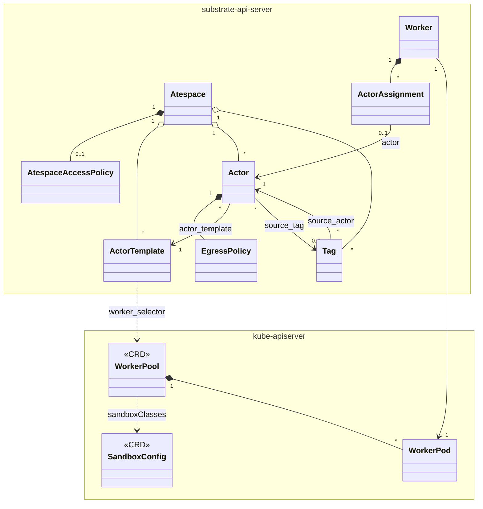

# Resource Model and Vocabulary

The nouns. Get these exactly right before reading any code — most confusion in this project is vocabulary confusion, especially **atespace ≠ Kubernetes namespace** and **pause ≠ suspend**.

Sources: `docs/glossary.md`, `docs/resource-model.md`, `pkg/proto/ateapipb/ateapi.proto`, `pkg/api/v1alpha1/`.

## The hierarchy

```
Global
├── AccessPolicy "default"         subresource (singleton)
├── Atespace                       global-scoped
│   ├── AccessPolicy "default"     subresource (singleton)
│   ├── ActorTemplate
│   ├── Actor
│   │   └── EgressPolicy "default" subresource (singleton)
│   └── Tag
└── Worker                         global-scoped
    └── ActorAssignment            subresource, one per hosted Actor, Substrate-written
```

"Global" is the root of the hierarchy, not a resource. A **subresource** is always reached through its parent and dies with it.

| Resource | Scope | Written by | Lives in |
|---|---|---|---|
| `Atespace` | Global | clients | PostgreSQL |
| `ActorTemplate` | Atespace | clients | PostgreSQL |
| `Actor` | Atespace | clients (status: Substrate) | PostgreSQL |
| `Tag` | Atespace | clients (status: Substrate) | PostgreSQL |
| `Worker` | Global | **Substrate** (`ate-controller`'s workersync) | PostgreSQL |
| `ActorAssignment` | subresource of Worker | Substrate (the scheduler) | PostgreSQL |
| `EgressPolicy` | subresource of Actor, singleton `default` | clients | PostgreSQL |
| `AccessPolicy` | subresource of Global or Atespace, singleton `default` | clients | PostgreSQL |
| `WorkerPool` | **Kubernetes, namespaced** | clients | etcd |
| `SandboxConfig` | **Kubernetes, cluster-scoped** | clients | etcd |
| `CSIDriverConfig` | **Kubernetes, cluster-scoped** | clients | etcd |

## Atespace

The isolation boundary and the first half of an actor's identity: an Actor is addressed `(atespace, name)`, so the same name can exist in two atespaces.

- **Global-scoped, not a Kubernetes namespace.** `metadata.atespace` is always empty on an Atespace; its identity is `metadata.name`.
- `ActorTemplate`s also live in an atespace. `WorkerPool`s live in **Kubernetes namespaces** — a different axis entirely.
- Must exist before any Actor can be created in it. Can only be deleted once empty (actors, templates *and* tags all block it; the SQL uses `ON DELETE RESTRICT`).
- Deleting an atespace deletes its `AccessPolicy`, so a recreated atespace starts with none.
- `ate-golden` is a **reserved** atespace holding every template's golden tag.
- Atespace separation is today a grouping + storage-prefix + authorization boundary. It does **not** yet enforce inter-atespace network policy or resource quotas (`docs/security.md` marks it In-Progress).

## ResourceMetadata — shared by every gRPC resource

`ateapi.proto:428`. Every Substrate resource carries one.

| Field | Semantics |
|---|---|
| `atespace` | Caller-specified at create, **immutable**. Empty for global-scoped. |
| `name` | Caller-specified, **immutable**, unique within its atespace. `k8s-short-name` format (DNS-1123 label). |
| `uid` | **Server-assigned**, globally unique, immutable. Ignored on create; a **precondition** on update. |
| `version` | **Monotonic**, bumped on every mutation. Ignored on create; a **precondition** on update. This is the optimistic-concurrency token. |
| `create_time` / `update_time` | Server-set, ignored on input. Custom validation enforces `update_time >= create_time`. |

The `uid`+`version` pair is how every update is made safe. `store.Precondition` carries them; a mismatch is a conflict. This matters a lot in the workflows — see [control-plane.md](control-plane.md).

## Actor

One instance derived from an `ActorTemplate`. The unit that is suspended and resumed, and it **moves between workers over its lifetime**.

Spec fields (`ateapi.proto:532`):
- `actor_template` (`ObjectRef`, **mutable**) — may be repointed while SUSPENDED. A resume that finds the snapshot's `actor_template_uid` disagrees restores durable data only and cold-boots the guest.
- `worker_selector` (optional `Selector`) — per-actor placement constraint. The scheduler evaluates the **AND** of this and the template's `worker_selector`. Takes effect on the next `ResumeActor`. *Pinning a sandbox class belongs on the template, not here.*
- `source_tag` (optional `ObjectRef`, **immutable**) — the Tag this actor was seeded from.
- `status` — server-owned, ignored on input.

### ActorState

```
          CreateActor
              ↓
         SUSPENDED ──ResumeActor──► RESUMING ──restore/boot done──► RUNNING
              ▲                                                       │
              │                                           SuspendActor│PauseActor
              │                                                       ↓
              └────────────checkpoint complete──────────────── SUSPENDING
         SUSPENDED ──SuspendActor (paused: uploads node-local)──► SUSPENDING
         SUSPENDED ──DeleteActor──► gone
```

Enum values (note the gaps — 5 and 6 were removed, and `AGENTS.md` forbids `reserved`): `UNSPECIFIED=0, RESUMING=1, RUNNING=2, SUSPENDING=3, SUSPENDED=4, CRASHED=7, DELETING=8, REVERTING=9`.

### ActorStatus (`ateapi.proto:866`)

| Field | Meaning |
|---|---|
| `state` | the enum above |
| `worker_assignment` | the Worker hosting it. Unset in SUSPENDED/CRASHED. Marked `+k8s:update=NoModify`: can be set and cleared, never changed in place. |
| `assigned_node` | the Kubernetes node the actor is **attached** to — hosting its worker *or* holding its node-local snapshots. This is the node pin. |
| `snapshots` | up to 16 `Snapshot` generations, keyed by `generation`. |
| `last_assigned_generation` | monotonic, **never decreased even on revert**, so stale snapshots stay identifiable for GC. |
| `external_volumes` | per-actor CSI volumes (preview-gated `ExternalVolumes`). |
| `crash` | `message` + `crash_time`, set with CRASHED, cleared by a revert. |

### WorkerAssignment is deliberately denormalized

`ateapi.proto:950`. It carries `worker` (the `ObjectRef` you look the Worker up by) **plus copies** of `worker_namespace`, `worker_pool`, `worker_pod`, `worker_pod_uid`, `worker_pod_ips`, `node_name`, `worker_epoch`, `sandbox_runtime`, `worker_spiffe_id`.

Why: `atenet-router` reads `worker_pod_ips` and `worker_spiffe_id` **on the request-routing hot path** and must not need a second lookup. The copies stay valid because a Worker's identity fields are immutable. Only `worker` identifies the Worker to the API.

## ActorTemplate

The definition of an actor "class". **Treated as immutable** — create a new template for a new version rather than editing. Analogous to a Pod template but for a checkpointable workload. Created through the gRPC API (`kubectl ate create actor-template`), **stored in the control-plane DB, not Kubernetes.**

| Field | Notes |
|---|---|
| `containers` | 1–10, list-map by `name`. Images **must be pinned by digest** (`name@sha256:...`). Env supports literal `value` only — no `$(VAR)` interpolation, no `envFrom`/`valueFrom`. Optional `wakeupProbe` (HTTP GET) per container. |
| `volumes` | 0–32, list-map by `name`. Each is a `durableDir`, an `externalVolumeTemplate` (CSI), or a `systemInfo` volume. **Every declared volume must be mounted by at least one container.** |
| `snapshot_config` | `storage_location` (required base URI), `preferred_fidelity`, `golden_snapshot_config.mode`. |
| `resources` | **Required**, and `limits` must set **both** `cpu` and `memory`. |
| `worker_selector` | gates eligible pools by label; also **the way a template pins a sandbox class**. |
| `status.golden_snapshot_status` | `golden_tag` ObjectRef, `snapshot_time` (when warmup ends), `error_message` (nonempty is **terminal**, formatted `<Reason>: <detail>`). |

### `resources.limits` does two separate things

1. **Sizes the sandbox.** gVisor: `limits.cpu` → cgroup v2 `cpu.max` + Sentry vCPU count (`--cpu-num-from-quota`); `limits.memory` → `memory.max` and the *virtual total memory the sandbox reports* (so a JVM/Go runtime doesn't over-allocate from host RAM). Micro-VM: `limits.cpu` → CH `BootVcpus`/`MaxVcpus` rounded up to whole vCPUs; `limits.memory` → guest RAM minus `--vmm-mem-reserve-mib` (default 256 MiB) held back for the VMM and virtiofsd so the pod cgroup doesn't OOM.
2. **Gates scheduling.** Placed only on a worker whose remaining capacity ≥ these limits.

`requests` are **not consulted today.** Because size is baked into snapshots, a micro-VM MEMORY-fidelity restore **reuses the size in the snapshot**; changing limits takes effect on the next cold boot.

## Snapshots

### Fidelity — a ladder, each level includes the ones below

| Fidelity | Holds | Resume behavior | Served by |
|---|---|---|---|
| `VOLUMES` (1) | contents of snapshot-capable volumes (`DurableDir` today) | containers **cold-boot** from the OCI image with volumes restored | both classes |
| `ROOTFS` (2) | + rootfs changes since boot | containers **cold-boot** with their rootfs writes back in place | **micro-VM only** — gVisor keeps rootfs changes inside its memory checkpoint, so a gVisor template requesting it is **rejected** |
| `MEMORY` (3) | + process memory | resumes **where it left off** | both classes |

`preferredFidelity` is a **best-effort ceiling**, not a guarantee: the system never packages more, and may package less when a layer can't be captured or is too expensive right now (e.g. memory under host pressure). **A process resumed in place on its worker keeps its memory regardless.**

### Snapshot record (`ateapi.proto:325`)

| Field | Meaning |
|---|---|
| `uuid` | server-generated. Names the node-local checkpoint **and** is the last path segment in object storage. |
| `generation` | monotonic from 1 |
| `owner` | `SNAPSHOT_OWNER_ACTOR` or `SNAPSHOT_OWNER_TAG` (golden snapshots are tag-owned) |
| `fidelity` | what it actually holds |
| `actor_template_uid` | the template whose sandbox the guest state came from — **not always the template the actor points at now** |
| `locality` | the node holding its **local files**. Set when a pause completes, cleared when the files are deleted. A resume restores from them **without deleting them**. |
| `durable_snapshot` | `{status: PENDING|COMPLETED, object.snapshot_uri}`. Absent when the snapshot is node-local only. |
| `sandbox_runtime` | the `SandboxRuntime` + compat attributes the capture ran under |

### The three snapshot kinds

- **Golden Snapshot** — captured once when an `ActorTemplate` is created, from a temporary "golden" boot. Always a **MEMORY** capture regardless of `preferredFidelity`. Owned by a tag in the reserved `ate-golden` atespace. Disable with `snapshotConfig.goldenSnapshotConfig.mode: GOLDEN_SNAPSHOT_MODE_DISABLED` (then actors cold-boot).
- **Last Snapshot** — the most recent per-actor snapshot, written on Suspend, used on the next Resume.
- **Tag snapshot** — a tag's own copy, made at tag creation.

### Storage layout — the owner is in the path

```
<storageLocation>/atespaces/<atespace>/actors/<actor uid>/snapshots/<snapshot name>
<storageLocation>/atespaces/<atespace>/tags/<tag uid>
```

A snapshot's objects (manifest, memory image, durable-data tar) sit below that prefix. An actor takes a series, so it gets a prefix of its own; **a tag holds exactly one, so the tag's prefix *is* its snapshot's prefix.**

Both owners are keyed on **UID**, so recreating an actor or tag under the same name never inherits its predecessor's objects. "Collecting an owner" = deleting everything under its prefix, and it **can delete nothing else** — which is exactly what makes a borrowed (tag) snapshot safe: an actor seeded from a tag points at a URI under `tags/`, outside its own prefix.

The `<atespace>` level exists so access can be granted per tenant: an object-storage IAM policy can only condition on an **object-name prefix** and cannot read identity out of a snapshot manifest. **Consequence worth planning for:** cloning across atespaces via a `PUBLISHED` tag reads the *source* atespace's prefix, so the reader needs a grant covering it — the target atespace's grant is not enough.

## Tag

An Atespace-owned, stable, **immutable** name for exactly one external snapshot, and a **retention pin**.

- It holds **its own copy** of the snapshot, made at creation, so it outlives the actor that took it.
- `scope`: `TAG_SCOPE_ATESPACE` (seeds actors only in the owning atespace) or `TAG_SCOPE_PUBLISHED` (any atespace, **still addressed through its owning atespace**).
- `source_actor` — the suspended Actor whose snapshot it captures. Immutable.
- `status.snapshot` is recorded with `durable_snapshot: PENDING` **right after the tag is reserved, before anything is copied**, and flips to `COMPLETED` once the copy finishes. A tag only seeds actors once `COMPLETED`; a tag whose creation failed early never gets one (but one whose copy failed mid-way **does** name the partial copy, so it can be collected).
- Actors can only be seeded from a tag under the **same `ActorTemplate` UID** (`TagStatus.actor_template_uid`).
- Deleting a tag deletes that copy. An atespace with tags cannot be deleted.
- **Known security limitation** (`docs/authorization.md`): a tag is a durable copy of an actor's memory *and disk, including secrets*, that outlives the actor. Any atespace editor can tag, publish and clone any actor in the atespace.

## Worker

A record representing **one worker pod**. Created by `ate-controller`'s `workersync`, not by users. Named by the pod UID (so `name` alone is the primary key).

Immutable at creation: `worker_namespace`, `worker_pool`, `worker_pod`, `worker_pod_uid`, `node_name`, `ips` (at most one per family, Kubernetes order, first is the primary family), `worker_spiffe_id`, `sandbox_class`.

| Field | Notes |
|---|---|
| `labels` | mirror the **`WorkerPool` object's** Kubernetes labels (max 64). These are what selectors match — **not** `spec.template.labels`. |
| `epoch` | counts runs of the worker pod's worker container: 1 for its first run, +1 per restart. 0 = not reported. May only increase. **A restarted worker has lost its sandboxes, so once epoch rises the control plane crashes every Actor placed in an earlier epoch;** `status.observed_epoch` reports when that's done. |
| `status.capacity` / `status.allocated` | `WorkerResources`: a `Resources` (cpu/memory) plus an `actors` count. Shrinking capacity below allocated blocks new placements but **does not evict**. |
| `status.default_runtime` | what new and cold-booted actors start under |
| `status.restorable_runtimes` | up to 32 **additional** runtimes it can restore snapshots from right now |

### WorkerState

| State | Schedulable | Notes |
|---|---|---|
| `ACTIVE` | yes | ready |
| `DRAINING` | no | pod terminating. **Final** — never becomes active or unavailable again. |
| `UNAVAILABLE` | no | registered but not Ready, or restarting. **Every Worker starts here** until `MarkWorkerAvailable`. |

Clients move state only through `DrainWorker` / `MarkWorkerAvailable` / `MarkWorkerUnavailable`; whatever a Create/Update request carries in `status` is **ignored**.

### SandboxRuntime compatibility — read this carefully

`SandboxRuntime = {sandbox_class, version: VersionedSandboxCompat{schema_version, attributes[]}}`.

Matching rule, under the **same `schema_version`**: every attribute recorded **on the snapshot** must be present on the worker with an **equal** value — *except* `cpu_features`, where the snapshot's hex bitmask must be a **bitwise subset** of the worker's. Keys only the worker has are ignored, so a worker can gain keys under one `schema_version` without invalidating older snapshots. **Removing or recomputing a key requires a new `schema_version`**, under which older snapshots no longer match.

`ate-api-server` sorts attributes by key before recording them, so send order doesn't matter.

Example attribute keys: `sandbox_bundle_hash` (runtime assets), `architecture`, `cpu_features` (effective guest hardware after masking).

### What happens when no compatible worker has room

- **Durable snapshot** (the actor's own, a `sourceTag` clone, or a golden snapshot): falls back to **any** eligible worker and **downgrades the restore to `VOLUMES`** — volume data preserved, guest booted fresh under the new worker's `defaultRuntime`.
- **Local pause checkpoint** (has `locality`, no `durableSnapshot`): **not relaxed.** The resume returns `RESOURCE_EXHAUSTED` and the actor stays paused on its node. Suspending it uploads the checkpoint and lifts the node pin, after which its next resume may fall back like a durable one.
- A snapshot with no `sandbox_runtime`, or at `VOLUMES` fidelity, **imposes no runtime placement constraint.**

`SandboxClass` is a **harder** constraint than `RequiredRuntime`: a snapshot's files (volumes included) are written by one class's worker and read back by the same, so it holds at **every** fidelity and is never relaxed (`cmd/ateapi/internal/scheduling/scheduling.go:32`).

## WorkerPool (Kubernetes CRD, namespaced)

`pkg/api/v1alpha1/workerpool_types.go`. Reconciled into a `Deployment` by `ate-controller`.

```yaml
apiVersion: ate.dev/v1alpha1
kind: WorkerPool
metadata:
  name: agent-pool
  namespace: ate-demo
  labels:
    workload: secret-agent          # <-- THIS is what actor selectors match
spec:
  replicas: 10
  workerImage: ko://go.ate.dev/substrate/cmd/ateworker-gvisor
  sandboxClasses:
  - name: gvisor                    # required, immutable; gvisor|microvm
    configRef: {name: gvisor-default}   # optional; else the class default
  template:                         # optional WorkerPoolPodTemplate
    labels: {project: agent-platform}   # <-- only Kubernetes workload metadata
    annotations: {policy.example.com/exemption: sandbox-host}
    nodeSelector: {}
    tolerations: []
    priorityClassName: ""
    nodeAffinity: {}
    resources: {}                   # <-- worker CAPACITY
    serviceAccountName: ateworker   # default; controller creates it
```

- Exactly **one** `sandboxClasses` entry today. `name` drives the worker pod shape (KVM device mounts, node placement).
- **Keys in `ate.dev/` and its subdomains (e.g. `policy.ate.dev/`) are reserved** and rejected in `template.labels`/`template.annotations`.
- **`template.labels` does not affect actor scheduling.** Actor selectors match `WorkerPool.metadata.labels`. This trips people up.
- `spec.template.resources.limits` on the `ateworker` container is the worker's **capacity** — a shared budget each placed actor subtracts its limits from. A worker that declares no limit for a dimension reports **zero** capacity for it, which the scheduler treats as **unconstrained** (placement is never blocked by missing data).
- A worker also has an actor cap: `ateworker --max-actors`, default **1000**. Placement stops at whichever runs out first.
- **GPUs/devices are temporarily unsupported.** A `nvidia.com/gpu` pool limit is now just an ordinary extended resource: it places the pod on a GPU node and reserves the device, and nothing reads it. Device pass-through was removed while the API is redesigned, because a resource name + count cannot express which container gets a device, sharing, or resuming onto compatible hardware.

### Status
`status.sandboxClasses[]` carries `name`, `configRef.name` (in use), `pendingConfigRef.name` (transient, during a switch), and `conditions`. The `Resolved` condition is `True`/`Resolved`, or `False` with reason `SandboxConfigNotFound` | `SandboxConfigDeleting` | `SandboxClassMismatch` | `DefaultConfigNotFound` — and then `configRef` **keeps the last resolved config** while the controller emits a Warning event. The controller creates the Deployment **only once every class has a config**, but keeps updating an existing one while a class is unresolved. Each `configRef` change emits a Normal `SandboxConfigSwitched` event naming old and new, so `kubectl events --for workerpool/NAME` shows recent history (API server keeps events ~1h).

## SandboxConfig (Kubernetes CRD, cluster-scoped)

`pkg/api/v1alpha1/sandboxconfig_types.go`. Decouples **the sandbox** (its binaries + the pause image) from the workload definition. The sandbox binaries are **not baked into the worker image**.

```yaml
spec:
  sandboxClass: gvisor              # gvisor|microvm, default gvisor
  defaultVersion: v1                # must name an Enabled entry in versions
  versions:                         # 1–16, list-map by name
  - name: v1
    state: Enabled                  # Enabled (default) | Disabled
    pauseImage: ...@sha256:...      # REQUIRED for gvisor, FORBIDDEN for microvm
    assets:                         # keyed by GOARCH, then asset name
      amd64:
        gvisor: {url: "gs://gvisor/...", sha256: "<64 hex>"}
```

- `AssetFile.sha256` both **names the cached file** (preventing collisions) and verifies the download. Lower-case hex, 64 chars, enforced by pattern.
- Assets are fetched **through the node's object-store plugin with the plugin's credentials**. The plugin refuses URLs under a snapshot location and serves only its backend's scheme (`gs://` on GCS, `s3://` on S3). A `gs://` URL the plugin can't serve is then read **anonymously** — which is how public buckets like `gs://gvisor` work. atelet has **no object-storage credentials of its own** and verifies the sha256 again itself.
- Asset names are interpreted by the backend: gVisor expects a `gvisor` asset (the release's `gvisor.tar.zstd`, extracted so the `gvisor-bin/` helpers sit next to `runsc`; a legacy bare-binary `runsc` asset is still accepted). Micro-VM expects several — `cloud-hypervisor`, `kata-kernel`, `kata-image`. The schema is deliberately generic; **per-class requirements are enforced by a ValidatingAdmissionPolicy** (`manifests/ate-install/sandboxconfig-validation.yaml`).
- CEL validations on the spec: `defaultVersion` must name an existing version, that version must not be `Disabled`, and `pauseImage` must be set on every version iff `sandboxClass == gvisor`.
- **Class default**: annotate `sandboxconfig.ate.dev/is-class-default: "true"`. More than one config of a class may carry it; **the newest wins.**
- The resolved version is **pinned into each snapshot's manifest**, so restores stay reproducible across runtime upgrades. Non-default Enabled versions stay in the worker's `restorableRuntimes` so existing snapshots can still restore.

### Deletion protection (a three-step dance worth understanding)

`ate-controller` puts `sandboxconfig.ate.dev/workerpool-protection` on a config **before any WorkerPool's status records it**.

1. A delete only sets `deletionTimestamp`; the config stays `Terminating`.
2. The controller checks whether any WorkerPool's `status.sandboxClasses` names it in `configRef` **or** `pendingConfigRef`. While one does, the finalizer stays and it rechecks on every WorkerPool change. Once none does, it removes the finalizer.
3. API server deletes it.

A pool switching configs names the new one in `pendingConfigRef` **first**; the controller then reads the config from the API server and moves `configRef` to it **only if that read finds it is not being deleted**. So a config is never released while a pool's `configRef` names it. **Without `ate-controller`, step 2 never happens** and the config stays Terminating until someone clears the finalizer by hand. A config no pool has ever used carries no finalizer and deletes at once.

## Lifecycle verbs — the distinctions that matter

| Verb | What happens |
|---|---|
| **Suspend** | Hibernate into a **durable** snapshot in external storage. A RUNNING actor is checkpointed on its worker (which is then freed); a **paused** actor's node-local snapshot is uploaded — narrowed to the commit scope if the pause captured more — ending its node pinning. |
| **Pause** | A **short-term** checkpoint. Snapshot files stay on the node VM, and the next Resume is **prioritized onto that node**. |
| **Resume** | Activate a SUSPENDED/paused actor onto a worker. The common path restores from a snapshot rather than cold-booting. |
| **Revert** | From RUNNING, CRASHED, or paused → SUSPENDED **at the durable snapshot**. Terminates any active sandbox, discards the local pause checkpoint and any partial in-progress snapshot, preserves the last **completed** external snapshot. |
| **Delete** | By default only from SUSPENDED or CRASHED. With the `any_state` flag, from any state: the workflow terminates containers, detaches volumes, frees the worker, then deletes the record. State is GC'd after. |

### Pause vs suspend: both land in SUSPENDING then SUSPENDED

They differ **only in the shape of `status.snapshots`**:

| | after a **pause** | after a **suspend** |
|---|---|---|
| latest snapshot `locality` | set (the node holding its files) | — |
| latest snapshot `durable_snapshot` | absent | `COMPLETED` |
| `status.assignedNode` | set — **actor pinned to that node** | cleared |
| next `ResumeActor` | restores there from local files | schedules anywhere eligible |

## DurableDir volumes

A directory mounted into one or more containers (possibly at different paths) whose contents are preserved by **`VOLUMES` fidelity** and therefore survive Suspend/Resume independently of process memory or other rootfs writes. This is the per-actor application-data surface.

How many a template may declare depends on the sandbox class of the pool its actors land on:
- **micro-VM**: several — they're subdirectories of one virtio-fs share, so they cost nothing extra per volume.
- **gVisor**: **one**, until gVisor accepts more than a single durable mount.

Created `0777` like a Kubernetes emptyDir, so a container running as any user can write it; a snapshot restores it with the mode it had, so the container's own `chmod` survives.

## Relationships



## Where to read more

- `docs/glossary.md` — the canonical definitions. Short; read it whole.
- `docs/resource-model.md` — scope/parent/subresource rules.
- `docs/api-guide.md` — the configuration reference for `WorkerPool`, `ActorTemplate`, `SandboxConfig`, with worked examples, SystemInfo volumes, container capabilities, wakeup probes, and the full snapshot-storage-layout section.
- `docs/csi-volumes.md` + `docs/csi-deployment.md` — `CSIDriverConfig` and `externalVolumeTemplate`.
- `pkg/proto/ateapipb/ateapi.proto` — the authority. Every field has a real doc comment plus its validation tags.
